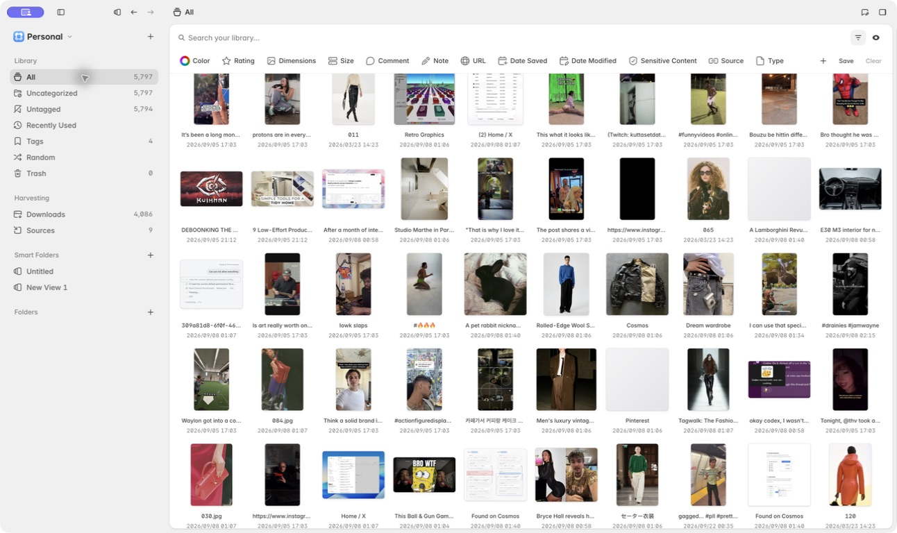
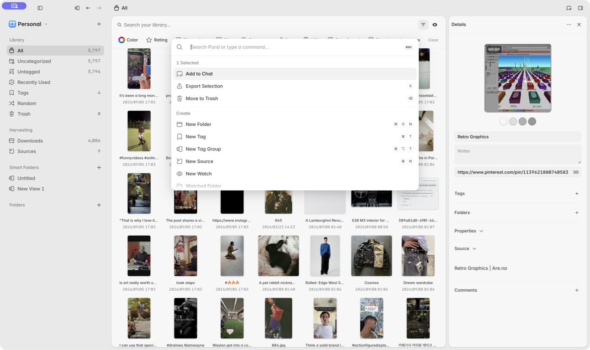
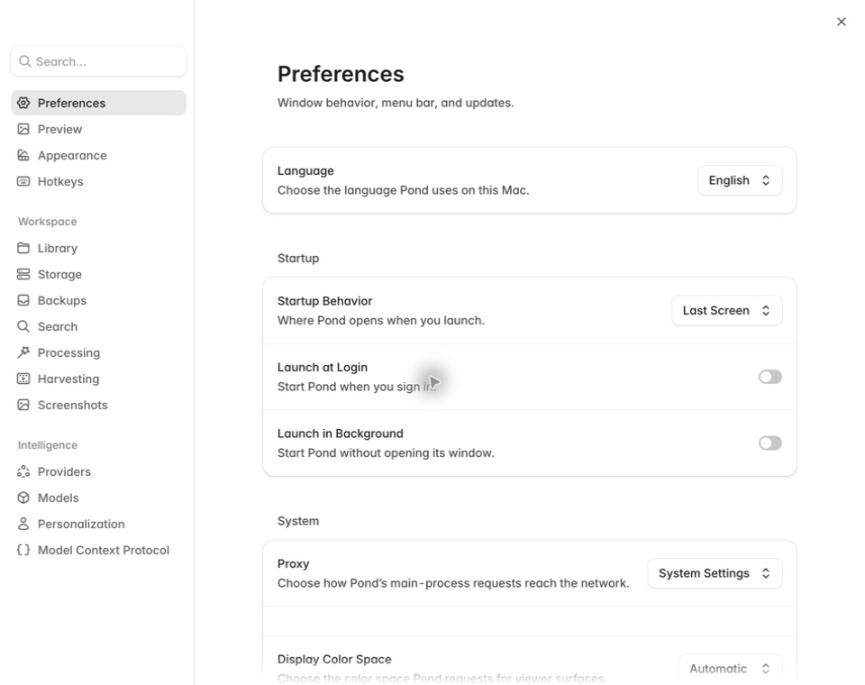
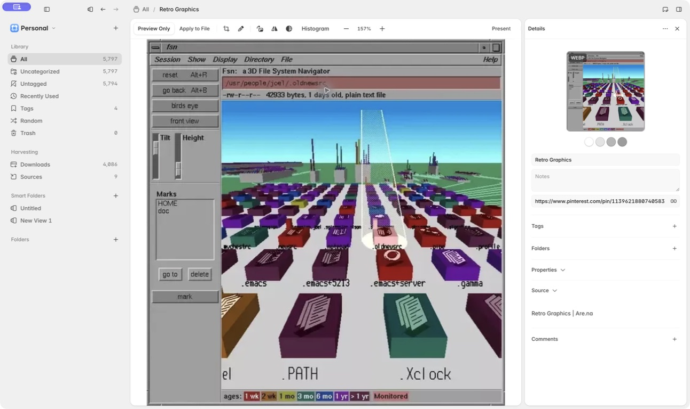
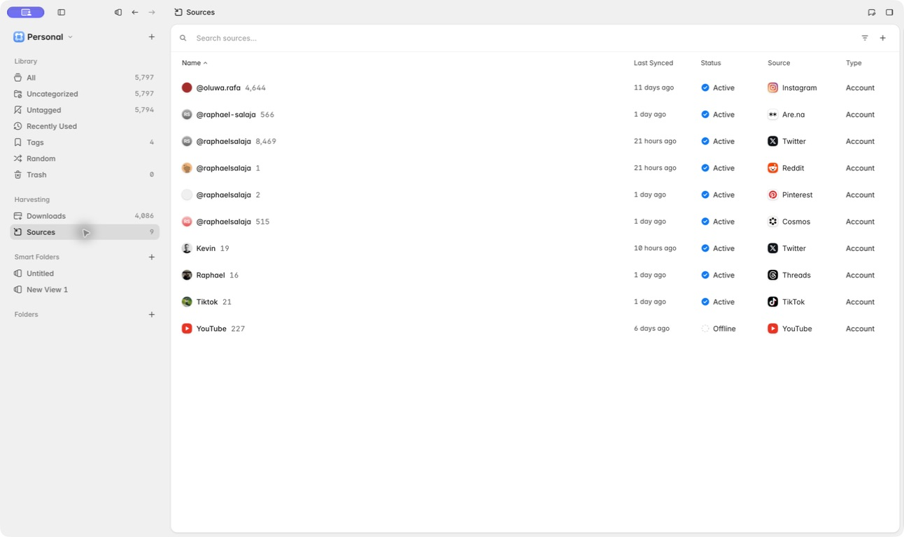

# Pond sharpness audit

Captured from the current desktop development build in light mode at 1292 × 768 (settings at 960 × 760) on 2026-09-23.

## Overall verdict

Pond already feels calm, native, and unusually complete. What keeps it from feeling *sharp* is not a lack of polish; it is that too many elements share the same quiet visual weight. The biggest lift will come from stronger hierarchy, less always-visible chrome, and more decisive treatment of the active object.

## 1. Library overview — needs hierarchy

Strengths: the three-pane structure is immediately understandable, the content stays central, and the selected state is crisp.

Risks: twelve filters remain visible when none is active, the grid is dense enough that saves become thumbnails rather than objects, and 10px title/date metadata reads as texture instead of useful information. The left sidebar, filter strip, gallery, and details pane all compete at nearly the same contrast level.

Recommendation: make the default chrome one search field plus **Filters** and **View** controls, then reveal only applied filter chips. At this viewport, target roughly 7–9 columns, lift titles to 11–12px, and show dates on hover/selection or behind a metadata preference.

## 2. Command menu — healthy; use as the north star

Strengths: this is the sharpest surface in the app. It has a clear focal point, strong depth, compact rows, and restrained grouping.

Risks: the selection context (`1 Selected`) is visually close to ordinary group labels, and the selected row relies heavily on a subtle gray fill.

Recommendation: give the selection context one compact accent treatment and make keyboard focus slightly more explicit. Reuse this surface's elevation and spacing model for other transient tools.

## 3. Settings — healthy

Strengths: title, descriptor, section heading, grouped card, and control form a clean hierarchy. This screen feels deliberate without feeling heavy.

Risks: the long sidebar is becoming a taxonomy rather than navigation, and low-contrast secondary copy will become tiring at smaller zoom levels.

Recommendation: keep this as Pond's hierarchy reference. Preserve the spacious content area, but consider making the sidebar groups collapsible or search-led as sections grow.

## 4. Save viewer — needs contextual editing

Strengths: the media is unmistakably the active object, and the editing toolbar stays compact.

Risks: the details pane repeats the same preview already filling the canvas, spending scarce vertical space on redundant information. Its title, fields, disclosures, and comments use nearly identical weight, so the most common edit is not obvious.

Recommendation: make the details pane state-aware. In gallery mode, keep the preview. In viewer mode, remove the duplicate preview and lead with title, source, tags, and folders; place properties and comments below clear disclosure boundaries.

## 5. Sources — functional but under-articulated

Strengths: the table scans quickly and brand marks make sources easy to recognize.

Risks: repeating `Active` on nearly every row spends attention on the normal state while the one offline source is easy to miss. The page also has a large unused field with no summary, explanation, or next action.

Recommendation: use exception-based status. De-emphasize or omit healthy status text, surface offline/failed rows with a clear action, and use a quiet summary in the header such as “9 connected · 1 needs attention.”

## Highest-impact changes

1. Collapse the empty filter strip and show applied filters only.
2. Increase default gallery scale and stop using 10px metadata as the normal reading size.
3. Establish one consistent state language across gallery, sidebar, tables, and command menu: hover, keyboard focus, selected, and active.
4. Make the details pane adapt to gallery versus viewer context.
5. Reserve accent color for active objects, current location, and exceptions; use neutral gray for structure.

## Accessibility and verification gaps

The screenshots show likely readability risk in 10px card metadata and low-contrast tertiary labels. Most shared controls appear to meet Pond's 24px minimum size token, but keyboard order, focus persistence, screen-reader announcements, dark mode, high-contrast mode, zoom/reflow, and motion behavior were not fully exercised in this pass.

## Runtime polish observed during capture

The development console reported duplicate ArrowLeft/ArrowRight registrations, which can make keyboard navigation feel unpredictable, and multiple thumbnail-generation failures, which can make the grid feel unreliable. These should be treated as interaction polish, not merely console cleanup.
