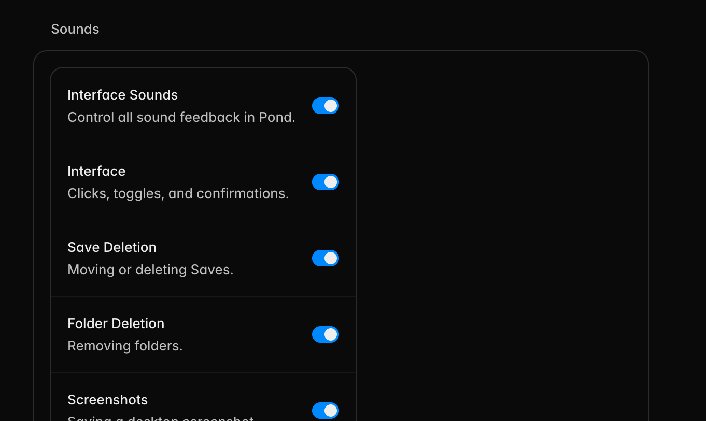

# Settings surface nesting audit

## Audit scope

Pond desktop Settings, focused on settings surfaces that render a complete `Settings.List` inside an engine-generated settings row and list.

User goal: each settings group should have one clear surface, without a card inside another card or unused space beside the inner card.

Accessibility target: preserve the existing control labels and reading order while removing the redundant container level.

## Evidence

The screenshot shows the problem in Appearance → Sounds: the full Sounds list is constrained inside a second, larger bordered surface. The live app and source audit found the same composition in Preferences → Sidebar and Preferences → Notifications.

## Steps and findings

1. **Appearance → Sounds — fixed.** The sound controls now render as the section's single settings list. The redundant generated list and row are no longer present.
2. **Preferences → Sidebar — fixed.** The sidebar controls now render as one full-width settings list, with no outer list or empty right-hand region.
3. **Preferences → Notifications — fixed.** Notification permission and event controls now render in one settings list rather than a list nested inside a row.
4. **Remaining Settings sections — healthy for this pattern.** Bespoke sections and group-level renderers already mount their lists directly. Row-level custom controls such as Language, Raycast, theme fields, and update actions intentionally render inside one generated row and do not create nested settings surfaces.

## Strengths preserved

- Existing section headings and descriptions remain unchanged.
- Switches, selects, and buttons retain their accessible labels and state.
- Settings search entries retain their existing section, keywords, and scroll targets.
- Mixed groups can place a standalone surface between ordinary rows without changing their order.

## UX and accessibility risks addressed

- Removed a false second level of hierarchy that made related controls look subordinate to an unnamed setting.
- Removed excessive empty space caused by a shrink-to-content nested list inside a full-width row.
- Simplified the accessibility tree by removing the extra generated settings row around each full settings surface.

## Evidence limits

The live macOS build was visually and accessibility-tree checked in dark mode. Automated rendering verifies the DOM relationship. This audit does not claim full WCAG compliance; light mode, forced colors, zoom/reflow, keyboard traversal, and screen-reader announcements were not exhaustively tested.
