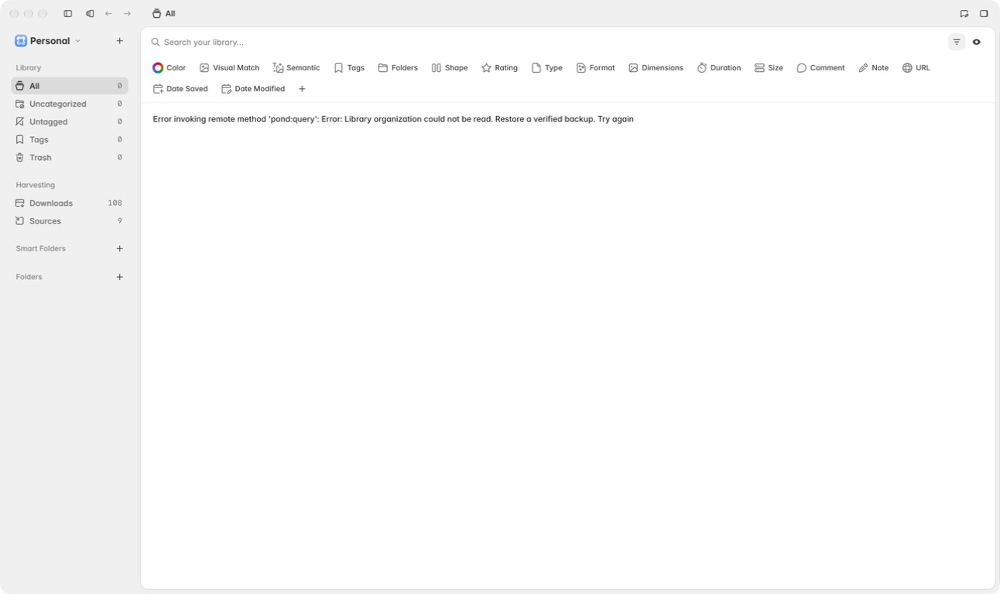
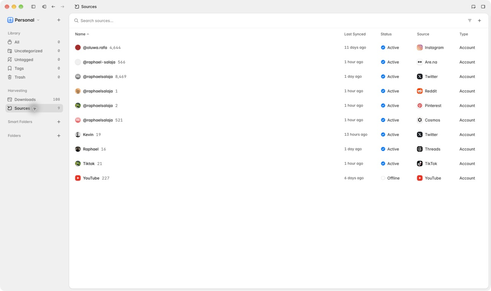
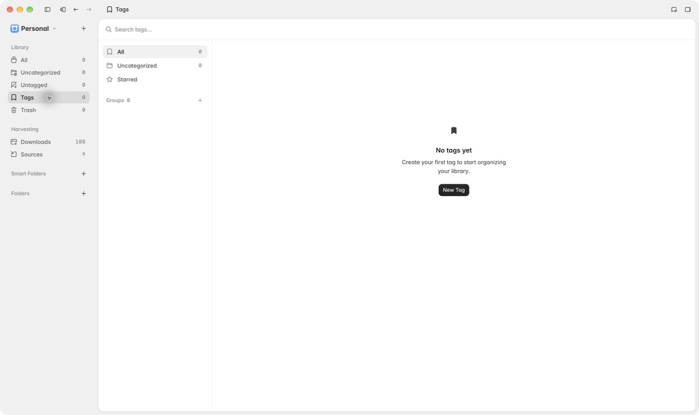
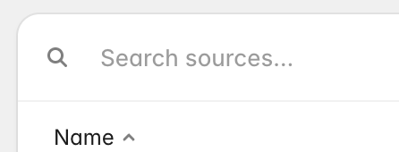
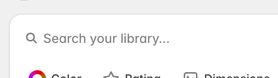
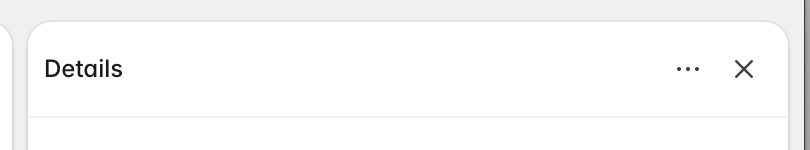
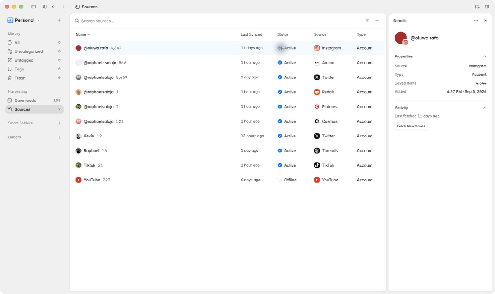
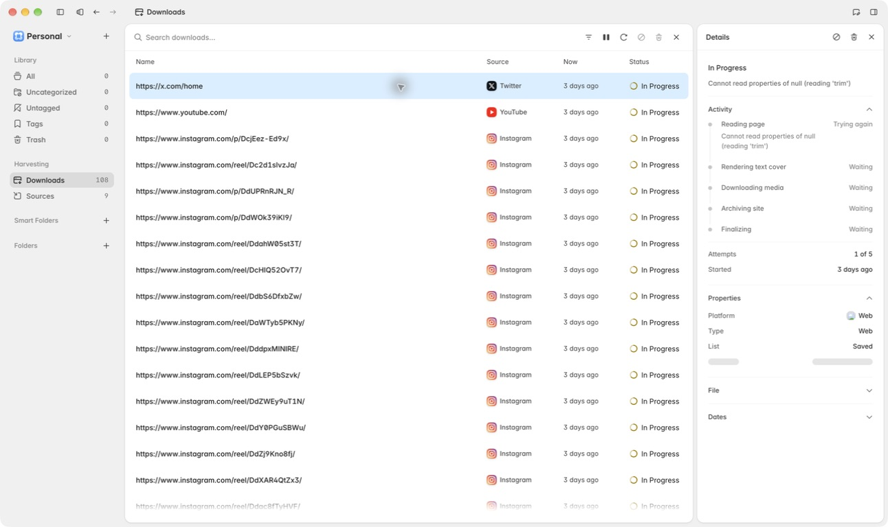
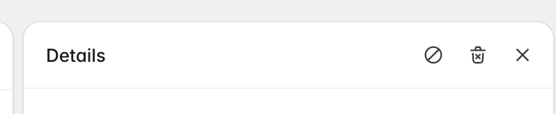
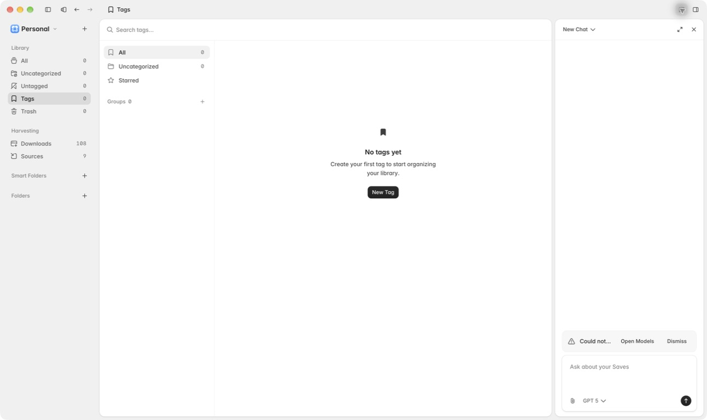

# Pond UI consistency audit

Date: 2026-09-24

## Audit scope

This audit covers repeated top-level chrome in the Library window:

- Library, Sources, Downloads, and Tags search headers
- Save, Source, and Download Details headers
- The adjacent Agent pane header
- The content inset immediately below inspector headers

Settings fields, popup search fields, dialog headers, viewer chrome, and embedded search controls are different interaction contexts and were checked only to make sure they are not accidental copies of the top-level chrome.

## Overall verdict

Pond already has most of the right shared pieces, but the visual contract stops one layer too early. `SearchChrome` consistently owns the outer 48 px search row, while its two content implementations render different inner spacing and placeholder styles. `TitleBar` consistently owns the inspector header grid and height, but each feature still owns the visible padding, type scale, divider, and action spacing. That feature-level ownership is the source of the drift in the supplied screenshots.

The fix should be a consolidation, not a series of local CSS patches.

## Evidence and steps

### Step 1 — Library search: needs alignment

The Library uses `SearchChrome` with the custom Lexical `SearchComposer`. Its text starts directly after the shared six-pixel gap because the editor placeholder is positioned at `left: 0`. The placeholder uses medium text, weight 450, and `--ds-gray-9`.

### Step 2 — Sources, Downloads, and Tags search: needs alignment

These pages use the same `SearchChrome`, but their `SearchChromeInput` wraps the generic `Input`. That input retains 12 px of inline field padding and the generic placeholder color/weight. Sources, Downloads, and Tags are consistent with one another; they drift from the Library search despite occupying the same top-level slot.

The supplied close-up makes the extra inner inset especially clear:

### Step 3 — Save Details: needs alignment

The Save inspector uses the shared `TitleBar`, but keeps its default small label, applies 8 px on every side, and does not add the four-pixel action gap used by the other inspectors. Its body also uses a 16 px horizontal inset.

### Step 4 — Source and Download Details: healthy relative to each other

Source and Download Details agree on the intended-looking variant: 16 px leading header inset, 8 px trailing inset, medium label, four-pixel action gap, divider, and 20 px horizontal body inset. They duplicate those decisions in separate feature CSS files, so they can still drift later.

The supplied close-up confirms the difference from Save Details:

### Step 5 — Agent pane header: needs convergence

The Agent occupies the same right-pane slot but uses a separate `AgentHeader`. It already owns a 48 px height, medium title, divider, and four-pixel action gap. Its leading inset is 8 px, so the pane changes alignment when switching between Agent and Source/Download Details.

## Component map

| Surface | Current component | What is shared | What still drifts |
| --- | --- | --- | --- |
| Library search | `SearchChrome` + `SearchComposer` | Row height, outer 16 px inset, magnifier, actions, divider | Inner text/placeholder contract |
| Sources, Downloads, Tags search | `SearchChrome` + `SearchChromeInput` | Same outer chrome | Generic input adds 12 px inner inset and different placeholder tone/weight |
| Save, Source, Download Details | `TitleBar` | 48 px grid and slots | Padding, label size, action gap, divider, body inset |
| Agent pane | `AgentHeader` | Complete header styling inside its own component | Separate component and 8 px leading inset |
| Sources and Downloads tables | `DataTable` | Header/row mechanics and identical grid variables | No relevant inconsistency found |

## Findings

### 1. High — Inspector chrome has no single owner

`TitleBar` is a layout primitive, not a pane-header component. Because it does not own padding, divider, title typography, action spacing, or body alignment, the three Details callers must recreate the visual contract. The Save caller chose one variant; Source and Downloads chose another. `AgentHeader` then recreated nearly the same right-pane header as a second shared component.

Recommendation: add a `PaneHeader` compound to `@pond/ui`, or add an explicit `pane` variant to `TitleBar`. It should own:

- 48 px total height
- 16 px leading and 8 px trailing inset
- medium title text and weight
- four-pixel action gap
- one standard divider token
- small ghost icon actions

`AgentHeader` should compose that primitive so chat-specific title behavior remains in the Agent feature. Save, Source, and Download inspectors should have no feature-local header spacing or typography CSS.

### 2. High — SearchChrome's child contract is incomplete

`SearchChrome` owns the magnifier, so its content slot must begin at the same x-position regardless of whether the child is a native input or a Lexical editor. Today `SearchChromeInput` passes through the generic `Input` defaults, adding 12 px of padding after the shared six-pixel gap. It also inherits a different placeholder color and weight.

Recommendation: make `SearchChromeInput` explicitly zero its field inline padding and use the same placeholder token/weight as `SearchComposer`. Keep this override local to SearchChrome; changing the global `Input` would disturb forms throughout the app.

### 3. Medium — Inspector body alignment changes with the inspected entity

Save Details uses 16 px horizontal body padding. Source and Download Details use 20 px. The switch is visible because all three occupy the same 340 px pane and share the same title.

Recommendation: introduce a small `PaneBody`/inset token or at least a shared `--pane-content-inset`. Standardize the horizontal inset; keep vertical padding feature-specific where the content genuinely needs it.

### 4. Medium — Behavior tests do not protect the visual contract

Current tests cover search behavior and inspector actions, but there is no test or visual fixture that compares the two SearchChrome content paths or the right-pane header variants. That made the duplicated CSS safe to change independently.

Recommendation: add one deterministic component screenshot containing:

- SearchChrome with `SearchComposer`
- SearchChrome with `SearchChromeInput`
- `PaneHeader` with one, two, and three actions
- Agent title content rendered through the same PaneHeader

The assertion should be on aligned geometry, not feature filenames or duplicated class names.

## Strengths

- The top-level search pages already share `SearchChrome`; the correction is localized.
- Source and Download Details already agree visually, giving the pane-header component a clear reference.
- Search inputs and header actions have accessible names in the inspected code.
- Decorative search icons are hidden from assistive technology.
- Sources and Downloads already share `DataTable` and the same table geometry; no table-header fork was found.

## Accessibility risks and limits

No missing accessible name was found on the audited search fields or close/action buttons. The screenshots and static inspection cannot confirm keyboard focus visibility, tab order, contrast ratios in every theme, or behavior at non-default zoom. Those should be verified after consolidation. The packaged app used for capture also reported a Library data error, so the Save Details evidence comes from the user's supplied screenshot plus the current source implementation.

## Recommended order

1. Add the shared pane-header contract and migrate Save, Source, Download, and Agent headers.
2. Normalize `SearchChromeInput` against `SearchComposer` without changing global `Input`.
3. Standardize the inspector horizontal body inset.
4. Add the small visual-contract fixture before doing any broader polish sweep.

