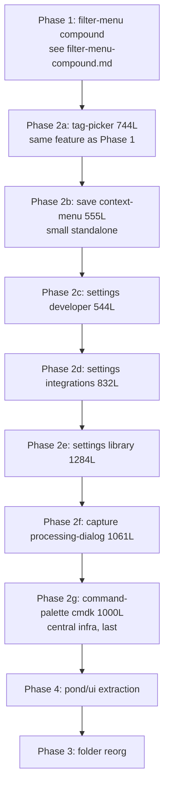

# Pond Components Refactor Master Plan

> **SUPERSEDED by [2026-05-27-library-view-shell.md](./2026-05-27-library-view-shell.md).** This master plan sequenced four workstreams: Phase 1 (filter-menu compound), Phase 2 (other oversized components), Phase 3 (folder reorg), Phase 4 (`@pond/ui` extraction). The product later pivoted to a unified `View` dropdown containing a row-based filter editor (Linear/Notion/Airtable pattern), which **changes the target shape for Phase 1 entirely** (no more `FilterMenu` compound, no chip bar; instead a `View` compound with `View.Filter` row editor inside). Phases 2, 4, and 3 of this document survive under new names: Phases E, F, G of the library-view-shell plan. Treat this file as historical context for the audit (Section 2), the per-file Phase 2 carve-out shapes (Section 3B), and the sequencing rationale (Section 4). Read [2026-05-27-library-view-shell.md](./2026-05-27-library-view-shell.md) for the current target shape and execution order.

> **For readers:** this document is the parent plan that established the four workstreams. Phase 1 has its own per-feature plan at [2026-05-27-filter-menu-compound.md](./2026-05-27-filter-menu-compound.md) (also superseded). The remaining phases are tracked at the phase level here; per-component task plans are generated lazily when each phase begins.

---

## Section 1: Executive summary

### The underlying problem

Depth in `apps/desktop/src/renderer/src/components/` reads as a folder problem at first glance. It is not. Depth is a downstream symptom of two component-shaping issues that the workspace `AGENTS.md` already names and constrains:

1. **Over-split components.** Tiny components that each get their own folder (`index.tsx` + `styles.module.css`) even though the workspace `AGENTS.md` says "default to a single file" and only promote to a folder when there is real reason to. The deletion test concentrates complexity rather than scattering it: deleting any one of these files would simplify the codebase, not redistribute its load.
2. **Under-split components.** Single files over 400 lines without an internal compound shape. The workspace `AGENTS.md` splits at 400+ lines via a context-driven compound (state context interface, named pieces). These large files combine multiple responsibilities and offer no interface to swap, no extension point, no targeted re-render boundary.

The folder depth that motivates the user's "I'm not a fan of the deep nested folder organisation" complaint goes away on its own once these two pathologies are fixed: most of the depth is over-split components forming `library/menus/filter/dropdowns/string/index.tsx` chains, and the rest of it is under-split parents that pull in tighter folder structures around them to localise their complexity.

### The four workstreams

| Phase | Workstream | Scope | Status |
|---|---|---|---|
| 1 | Filter-menu compound | One under-split parent (763 lines), six over-split children (22-194 lines each). Carve into `FilterMenu.{Root, ...}` compound; inline six dropdowns as named pieces. | Planned in [2026-05-27-filter-menu-compound.md](./2026-05-27-filter-menu-compound.md). |
| 2 | Other oversized files | Seven additional files over 400 lines: tag picker, save context menu, four settings sections, processing dialog, command palette. | Per-component plans generated lazily. |
| 3 | Folder reorg | Cap depth at `components/<domain>/<component>/`. Specific moves listed in §3C. | Planned in this document. |
| 4 | `@pond/ui` extraction | Promote app-local primitives (`_primitives/*`) to `packages/ui/src/*` per the workspace `AGENTS.md` "promote on second consumer" rule. | Planned in this document. |

### What this document is

This is a sequencing document. It establishes the audit findings, the target shape per file, the recommended ordering with rationale, the exit criteria, and the explicit out-of-scope list. Phase 1 already has full task-level detail in its per-feature plan; Phases 2 through 4 are described at the phase level here and grow detailed per-component plans when each starts.

### What this document is not

It is not a code-change document. No file edits, no migrations, no commits. The deliverable is this written sequencing. Once approved, Phase 1 begins execution against its existing per-feature plan; Phase 2 begins by generating its first per-component plan; and so on.

---

## Section 2: Consolidated audit

Vocabulary in this section follows `.agents/skills/improve-codebase-architecture/LANGUAGE.md` (module, interface, depth, seam, deletion test) and the workspace `AGENTS.md` thresholds (400-line split, "default to a single file" for trivia, "promote to compound" for parents).

### 2A. Shallow modules (over-split)

A module is shallow when its interface is roughly as wide as its implementation. The deletion test concentrates complexity rather than scattering it.

| Module | Lines | Verdict |
|---|---|---|
| `library/menus/filter/dropdowns/string/index.tsx` | 22 | Wraps `<Input.Field>` with one `onChange`. |
| `library/menus/filter/dropdowns/optional/index.tsx` | 55 | Wraps two `<Menu.Item>` rows. |
| `library/menus/filter/dropdowns/enum/index.tsx` | 86 | Toggle + multi-select on a presets array. |
| `library/menus/filter/dropdowns/number/index.tsx` | 92 | Presets + min/max range pair. |
| `library/menus/filter/dropdowns/date/index.tsx` | 106 | Presets + custom range + relative parsing already in `relative-time.ts`. |
| `library/menus/filter/dropdowns/tags/index.tsx` | 194 | Borderline: substantive grouping logic, but same `DropdownProps` contract as the other five. |

All six share `{ predicate, onChange }`, the same `.body / .search / .empty` CSS shape, and one consumer (`AddFilterMenu`). Per the workspace `AGENTS.md` "Unify" rule, the deletion test concentrates complexity into a single discriminated module: collapse into one component with six named bodies, one CSS Module, `data-variant` attributes for the per-type differences.

**Phase coverage:** Phase 1 owns this. The merge target was originally `FilterMenu.ValueEditor`; under the library-view-shell pivot it lands in `Filter.ValueSelect` inside the new View compound. The merge itself is identical either way.

### 2B. Deep modules with no seam (under-split)

A module is under-split when its line count exceeds 400 (workspace `AGENTS.md` threshold) and its body contains multiple internal sub-modules that share a domain bundle with no interface, no `Context`, no compound shape that would let one sub-module be swapped without editing the others in place.

| Module | Lines | Phase |
|---|---|---|
| `library/menus/filter/index.tsx` | 763 | Phase 1 |
| `library/menus/view/index.tsx` | 378 | Borderline; included in Phase 1 in the library-view-shell pivot |
| `save/preview/tag-picker/index.tsx` | 744 | Phase 2 |
| `save/context-menu/index.tsx` | 555 | Phase 2 |
| `settings/sections/developer/index.tsx` | 544 | Phase 2 |
| `settings/sections/integrations/index.tsx` | 832 | Phase 2 |
| `settings/sections/library/index.tsx` | 1284 | Phase 2 |
| `capture/processing-dialog/index.tsx` | 1061 | Phase 2 |
| `command-palette/cmdk/index.tsx` | 1000 | Phase 2 |

Per the workspace `AGENTS.md` compound-pattern reference, each becomes a `Feature = { Root, ... }` compound with a `FeatureContext` exposing `{ state, actions, meta }`. Named pieces consume the context interface, not the implementation. Phase 1 carves the filter-menu first to validate the pattern.

### 2C. Real seams to preserve

Architectural seams the audit confirms are load-bearing and must be preserved unchanged across all four workstreams:

1. **`useAddCommitApi`.** The URL-backed `AddCommitApi` adapter at `library/menus/filter/use-add-commit-api.ts`. Today's only adapter, but a hypothetical seam for future server-side persistence (e.g. saved views, multi-device sync). Phase 1 keeps the `AddCommitApi` interface; only the consumer changes (chip bar plus filter menu today, `ViewProvider` after the pivot).
2. **`CardContext`** in `_primitives/card-thumb/`. Already a context-driven compound. Untouched by every workstream. Phase 4 moves it to `packages/ui/` as-is.
3. **`@pond/ui` compound contexts** (`Menu`, `Popover`, `Select`, `Toolbar`, `Tabs`, `Switch`, `Slider`). Consumed across the whole renderer. No workstream alters the package's exports; Phase 4 only adds.
4. **TanStack Router search params.** The view config (`query`, `view`, `sort`, `dir`) lives in URL search. Phase 1 lifts the read side into `ViewProvider`; the write side remains `patchSearch(navigate, ...)` in `lib/navigate-path.ts`. Phases 2-4 do not touch routing.

### 2D. Out of scope (explicitly do NOT touch)

| Module / pattern | Reason |
|---|---|
| `_primitives/card-thumb/*` | Already a context-driven compound (`CardContext`). Folder structure exists because the compound has six pieces, each with substantial logic. Healthy depth. |
| `library/all-tags/{rail, tag-item}/` | Substantive logic, each ≥ 300 lines. Folder convention is appropriate for the workload. |
| The `index.tsx` + `styles.module.css` folder convention | The convention itself is fine; the problem is when it is applied to ≤ 100-line bodies. Phase 2's invariant (§5) bans new folders below that bar; existing folders are converted only when their parent feature is touched by another phase. |
| `library/menus/display/` (tags-route Display menu) | Different surface from the library-view Display section. Substantive enough; not on the audit list. Phase 3 renames the parent folder; the body stays. |
| Pond's existing motion primitives (`lib/motion.ts`) | Stable and consumed widely. No phase changes them. |

### 2E. What the audit does not cover

The audit is scoped to component shape, not to:

- Performance (re-render boundaries, memoisation, virtualisation)
- Accessibility audit
- Test coverage (Pond has no test framework today; out of scope)
- Type narrowing inside `Predicate` value bodies (the `value: unknown` discriminant could be tightened by field; orthogonal to component shape)
- Routing topology changes
- IPC contract changes

These are independent concerns that may be tackled later; none block the four workstreams here.

---

## Section 3: Workstreams

### 3A. Filter-menu compound (Phase 1)

The 763-line `library/menus/filter/index.tsx` is the audit's largest individual under-split. The six dropdown variants under `library/menus/filter/dropdowns/*` are the audit's clearest cluster of over-split modules. Phase 1 carves both at once into a single context-driven compound, validating the pattern that Phase 2 will apply to seven more files.

**Status:** Planned in detail at [2026-05-27-filter-menu-compound.md](./2026-05-27-filter-menu-compound.md). That plan has 9 tasks across three sub-phases (helpers extraction; compound shell + dispatcher; six-into-one merge; site migration). Each task carries full code, smoke steps, and a commit.

**Exit criteria for Phase 1:**

1. `FilterMenu` compound exported from `library/menus/filter/index.tsx` with `{ Root, SearchInput, FieldPicker, Field, Group, Results, ValueEditor, Empty }` (or whatever final shape the per-feature plan settles on; the library-view-shell pivot changes this to `Filter.{Root, Header, RowList, Row, Connector, FieldSelect, ComparatorSelect, ValueSelect, Delete, Reorder, Add, Empty}` and relocates everything under `library/view-menu/filter/`).
2. `dropdowns/` directory deleted; six bodies collapsed into one discriminated component.
3. Both call sites (toolbar Add-Filter button, chip bar `<AddTrigger>`) migrated. Note: under the library-view-shell pivot, **both call sites disappear**: the toolbar's filter button is removed entirely, the chip bar is deleted, and the only consumer is `View.Section "filter"`. Same merge work, smaller migration scope.
4. `pnpm typecheck && pnpm lint:check` clean.
5. Manual smoke pass: add filter, edit comparator, edit value, remove filter, clear all, all from URL state.

**Risk:** medium. The filter-menu is touched by routing, hotkeys, the chip bar, and the toolbar. The library-view-shell pivot reduces risk by removing the chip bar entirely (one fewer consumer) and consolidating the toolbar entry point.

### 3B. Other oversized components (Phase 2)

Seven additional under-split files, each treated as its own carve-out with its own per-component plan generated lazily when the phase starts. The format below is one subsection per file: current shape, target compound shape (named pieces + context bundle), estimated carve-out task count, risk, dependencies.

#### 3B.1. `save/preview/tag-picker/index.tsx` (744 lines)

**Current:** Monolithic tag picker drawn from `save/preview/pane`. Combines: tag search input, grouped tag list (by tag group, then "Uncategorised"), starred tags section, new-tag affordance, group-promotion affordance, tag-remove affordance, keyboard navigation. State is local to the component.

**Target:** `TagPicker = { Root, Search, Section, Tag, GroupSection, StarredSection, UncategorisedSection, Empty, NewTagAction }`.

**Context:** `TagPickerContext { state: { query, selected, allTags, groups, recents }, actions: { setQuery, toggleTag, createTag, promoteToGroup }, meta: { saveId } }`.

**Carve-out:** ~7 tasks (helpers extraction; provider; root + dispatcher; section types; tag piece; new-tag action; site migration).

**Risk:** medium. Touched by save preview pane, group filter add menu, possibly the command palette. Verify all consumers before deleting the old file.

**Dependencies:** Phase 1 sets the pattern. Same domain as Phase 1 (tags), so the data hooks (`useTags`, `useTagGroups`) and helpers (`predicateKey`, scoring) are already in fresh memory.

#### 3B.2. `save/context-menu/index.tsx` (555 lines)

**Current:** Monolithic `Menu.Root` wrapping ~12 `Menu.Item` groups: open, reveal in finder, copy URL, copy preview path, copy ID, copy as markdown, tag submenu, move-to submenu, star/unstar, mark as duplicate, delete.

**Target:** `SaveContextMenu = { Root, Section, OpenItem, RevealItem, CopyURL, CopyPath, CopyID, CopyMarkdown, TagSubmenu, MoveSubmenu, StarItem, DuplicateItem, DeleteItem }`.

**Context:** `SaveContextMenuContext { state: { save }, actions: { open, reveal, copyURL, copyPath, copyID, copyMarkdown, toggleTag, move, toggleStar, markDuplicate, delete }, meta: {} }`.

**Carve-out:** ~6 tasks (provider; root; copy items; tag submenu; move submenu; star/duplicate/delete + migration).

**Risk:** low. Standalone Menu, no shared state beyond `save`. Stable API surface.

**Dependencies:** none. Can be pulled forward if Phase 2a (tag picker) blocks.

#### 3B.3. `settings/sections/developer/index.tsx` (544 lines)

**Current:** Settings section with developer toggles: enable debug logging, show internal IDs, expose advanced filter options, dev-mode-only commands, log file viewer (`<LogViewer />`), reset-state button.

**Target:** `DeveloperSection = { Root, Toggles, LogViewer, ResetStateAction, AdvancedFlags }`.

**Context:** `DeveloperSectionContext { state: { flags, logLines }, actions: { setFlag, refreshLogs, resetState }, meta: { dispatch } }`.

**Carve-out:** ~5 tasks (provider; root + toggles list; LogViewer; ResetStateAction; AdvancedFlags + migration).

**Risk:** low. Self-contained settings surface. Only consumer is the Settings parent.

**Dependencies:** validates the Settings.* compound pattern that the next two sections inherit.

#### 3B.4. `settings/sections/integrations/index.tsx` (832 lines)

**Current:** Settings section with three integration cards (Browser extension, Raycast extension, Drop) plus shared scaffolding (status indicator, action buttons, configuration drawers). Each integration has its own state, error handling, and OAuth/setup flow.

**Target:** `IntegrationsSection = { Root, IntegrationCard, BrowserIntegration, RaycastIntegration, DropIntegration, ConfigDrawer, StatusBadge }`.

**Context:** `IntegrationsSectionContext { state: { integrations }, actions: { connect, disconnect, configure, test }, meta: {} }`.

**Carve-out:** ~7 tasks (provider; Root + scaffolding; IntegrationCard primitive; one task per integration; ConfigDrawer + migration).

**Risk:** medium. Touches IPC and OS-level integrations. The compound boundary is internal and does not affect IPC; verify by smoke after each task.

**Dependencies:** Phase 3B.3 establishes the Settings section pattern.

#### 3B.5. `settings/sections/library/index.tsx` (1284 lines)

**Current:** Largest under-split in the audit. Combines: pool location picker, library import/export, default tags configuration, archive policies, duplicate detection settings, file-system warnings, advanced storage flags.

**Target:** `LibrarySection = { Root, PoolLocationPicker, ImportExport, DefaultTags, ArchivePolicies, DuplicatePolicy, StorageFlags, WarningsBanner }`.

**Context:** `LibrarySectionContext { state: { poolPath, defaultTags, policies, warnings }, actions: { changePool, importLibrary, exportLibrary, setDefaultTag, setPolicy }, meta: {} }`.

**Carve-out:** ~9 tasks. The largest single carve-out in Phase 2.

**Risk:** medium-high. Pool-location changes are destructive operations; the chrome around them is load-bearing. Each task ends in a smoke pass that exercises the policy it touched.

**Dependencies:** Phases 3B.3 and 3B.4 establish patterns. This one runs last among the settings sections to benefit from muscle memory.

#### 3B.6. `capture/processing-dialog/index.tsx` (1061 lines)

**Current:** Capture pipeline progress dialog. Combines: step list (extract, screenshot, ocr, transcribe, classify, persist), per-step progress bar, log tail, retry/cancel affordances, error display, success summary.

**Target:** `ProcessingDialog = { Root, StepList, Step, ProgressBar, LogTail, RetryAction, CancelAction, ErrorPanel, SuccessSummary }`.

**Context:** `ProcessingDialogContext { state: { steps, currentStep, logs, status }, actions: { retry, cancel, dismiss }, meta: { captureId, dispatch } }`.

**Carve-out:** ~7 tasks (provider; Root + StepList; Step + ProgressBar; LogTail; Retry/Cancel; Error/Success; migration).

**Risk:** medium-high. UX-critical: this is the user's only window into a multi-second-to-multi-minute background operation. Compound carve must not change perceived latency, log scroll behaviour, or progress smoothness.

**Dependencies:** Phase 2's compound pattern muscle memory. Do once the settings sections have validated the shape.

#### 3B.7. `command-palette/cmdk/index.tsx` (1000 lines)

**Current:** Central command palette infrastructure: keystroke dispatcher, command registry consumer, result list with grouping, action dispatch, fuzzy search scoring, recents tracking, contextual command filtering by route.

**Target:** `CommandPalette = { Root, SearchInput, ResultGroup, ResultItem, ActionRow, Recents, EmptyState, Footer }`.

**Context:** `CommandPaletteContext { state: { query, results, recents }, actions: { search, run, dismiss }, meta: { registry } }`.

**Carve-out:** ~8 tasks. The longest queue.

**Risk:** high. Touched by every entry point in the app; smoke must cover all keystrokes, all registered commands, all contextual variants. Run last so every other refactor's stability is established first.

**Dependencies:** all prior Phase 2 work. Done last.

### 3C. Folder reorg (Phase 3)

Cap depth at `components/<domain>/<component>/`. The specific moves:

| From | To | Note |
|---|---|---|
| `library/menus/filter/` | `library/filter-menu/` | Phase 1 deletes the `dropdowns/` subtree first. Under the library-view-shell pivot, this becomes `library/view-menu/filter/` instead. |
| `library/menus/view/` | `library/view-menu/` | Under the pivot, the contents are rewritten entirely; the rename is moot because the rewrite happens in Phase 1's new shape. |
| `library/menus/display/` | `library/display-menu/` | Tags-route menu, unrelated to the library-view work. Rename only. |
| `library/menus/filter/dropdowns/*` | deleted | By Phase 1. |
| `settings/sections/developer/` | `settings/section-developer/` | Folder name only; body unchanged. |
| `settings/sections/integrations/` | `settings/section-integrations/` | Folder name only. |
| `settings/sections/library/` | `settings/section-library/` | Folder name only. |
| `save/preview/pane/` | `save/preview-pane/` | Rename out of the `preview/` parent. |
| `save/preview/media-viewer/` | `save/preview-media-viewer/` | Same pattern. |
| `save/preview/tag-picker/` | `save/preview-tag-picker/` | Same pattern. |
| `save/preview/{helpers.ts, rows.tsx}` | `save/{helpers.ts, rows.tsx}` | Pure-logic helpers move up a level. |
| `media/video-player/scrub-preview/` | `media/video-player-scrub-preview/` | Rename only. |
| `_primitives/` | removed | After Phase 4 empties it. If Phase 4 is deferred, rename to `ui/` instead. |

**One task per domain.** Each task is a `git mv` batch plus an import-path codemod (`rg --files-with-matches` plus `sed -i` over the matches, or a TypeScript-aware codemod with `ts-morph` if it is already in deps; otherwise plain `sed`). Each task ends in a `pnpm typecheck` + `pnpm lint --write` + smoke + commit.

**Exit criteria for Phase 3:**

1. Every component folder in `components/` is at depth `components/<domain>/<component>/` or shallower.
2. No `menus/` parent folder.
3. No `sections/` parent folder.
4. No `preview/` parent folder.
5. `pnpm typecheck && pnpm lint:check` clean.
6. Smoke pass for every renamed surface.

### 3D. `@pond/ui` extraction (Phase 4)

Move app-local primitives to the workspace package per the workspace `AGENTS.md` "promote to `@pond/ui` if a second consumer appears" rule. The promotion criterion is met for each item below: each has at least two consumers across the renderer.

| From | To |
|---|---|
| `_primitives/card-thumb/*` (Root + Media + Body + Title + Tags + Footer; 6 pieces) | `packages/ui/src/card-thumb/` |
| `_primitives/source-badge/` | `packages/ui/src/source-badge/` |
| `_primitives/number-field-stepper/` | `packages/ui/src/number-field-stepper/` |
| `_primitives/suggestion-toast/` | `packages/ui/src/suggestion-toast/` |

**Per-primitive task shape:**

1. Copy the source file(s) to `packages/ui/src/<name>/`. Preserve internal imports as relative paths within the package.
2. Add the package-local re-export to `packages/ui/src/index.ts`.
3. Run the renderer-side codemod that rewrites `@/components/_primitives/<name>` to `@pond/ui` imports.
4. Verify HMR works on a sample edit: the `@pond/ui` Vite alias in `apps/desktop/vite.config.ts` already pulls the package into the live module graph; an edit to `packages/ui/src/<name>/index.tsx` should hot-replace without a dev-server restart.
5. Delete the source from `apps/desktop/src/renderer/src/components/_primitives/<name>/`.
6. `pnpm typecheck && pnpm lint:check` + smoke + commit.

After all four primitives move, the `_primitives/` folder is empty and gets removed. Phase 3's `_primitives/` -> `ui/` rename becomes a no-op.

**Exit criteria for Phase 4:**

1. All four primitives importable from `@pond/ui`.
2. No `@/components/_primitives/*` imports anywhere in the renderer.
3. `_primitives/` folder removed.
4. `pnpm typecheck && pnpm lint:check` clean.
5. HMR verified on each primitive.

---

## Section 4: Recommended ordering

### Rationale

- **Phase 2 before Phase 3.** Do not move code that is about to be carved. The folder reorg should run against stable file shapes, not files mid-refactor.
- **Smallest oversized files first inside Phase 2.** Validate the compound pattern on low-risk surfaces (P2b, P2c) before tackling the multi-thousand-line ones (P2e, P2f, P2g).
- **Settings cluster in size order.** P2c (544L), P2d (832L), P2e (1284L) all live under `settings/sections/`. Running them in size order lets the pattern's muscle memory grow with the scope.
- **Same-feature affinity for P2a.** The tag picker (P2a) is the same domain as Phase 1 (tags). Running it immediately after Phase 1 keeps the data hooks, scoring helpers, and tag taxonomy in fresh working memory.
- **Central infra last (P2g).** The command palette is touched by every entry point in the app. Refactoring it last means every other surface is already stable, so smoke regressions are easier to attribute.
- **Phase 4 before Phase 3.** Extracting `_primitives/` to `packages/ui/` empties the folder, so Phase 3 has nothing to rename there. Conversely, if Phase 3 ran first, the `_primitives/` rename to `ui/` would have to be undone in Phase 4.

### Pull-forwardability

Each phase ends in a green `pnpm typecheck && pnpm lint:check` plus a manual smoke pass, so any phase can be paused or pulled forward without cascading damage. The dependencies in §3 list each phase's prerequisites (or "none"); a phase with no prerequisite can be pulled forward.

In particular:
- P2b (save context-menu) has no Phase 1 dependency. Can be done in parallel with Phase 1 if desired.
- P2c (settings developer) similarly has no Phase 1 dependency.
- P4 (pond/ui extraction) only depends on the existence of `_primitives/`, which is not touched by Phases 1, 2, or 3. P4 could even run first.

### Sequencing under the library-view-shell pivot

The pivot ([2026-05-27-library-view-shell.md](./2026-05-27-library-view-shell.md)) re-cards Phase 1 as Phases A through D (View shell, panel migration, Filter row editor, cutover) and renames Phases 2, 4, 3 to Phases E, F, G respectively. The DAG above remains valid up to the relabelling: Phase 1 in this document equals Phases A through D in the pivot; Phase 2 equals Phase E; Phase 4 equals Phase F; Phase 3 equals Phase G.

---

## Section 5: Exit criteria + tracking

### Top-level checkboxes

- [ ] Phase 1: Filter-menu compound shipped (or under the pivot: Phases A through D shipped).
- [ ] Phase 2: Seven oversized files carved to compounds.
  - [ ] Phase 2a: `save/preview/tag-picker/`
  - [ ] Phase 2b: `save/context-menu/`
  - [ ] Phase 2c: `settings/sections/developer/`
  - [ ] Phase 2d: `settings/sections/integrations/`
  - [ ] Phase 2e: `settings/sections/library/`
  - [ ] Phase 2f: `capture/processing-dialog/`
  - [ ] Phase 2g: `command-palette/cmdk/`
- [ ] Phase 3: Folder reorg complete; depth capped at `components/<domain>/<component>/`.
- [ ] Phase 4: `_primitives/` extracted to `packages/ui/`.

### Cross-cutting invariants (enforced after every phase)

1. **No new file over 400 lines without a `// REASON:` comment.** If a carve-out leaves a file at 410 lines because the named pieces collectively need that surface area, the file head gets a one-line `// REASON: 7 named pieces; further split would create shallow modules.` comment. Anything over 400 lines without that comment fails the post-phase audit.
2. **No new component folder containing only `index.tsx` + `styles.module.css` if `index.tsx` is under 100 lines.** Inline as a named piece in the parent feature folder instead. The workspace `AGENTS.md` already encodes this: "default to a single file". Each phase's smoke pass includes a quick scan of newly created folders against this bar.

### Pointers

- Workspace split rule: `AGENTS.md` "Files exceeding 400 lines should generally be split."
- Component compound pattern: `apps/desktop/src/renderer/src/components/AGENTS.md` "Compound components".
- Architecture vocabulary: `.agents/skills/improve-codebase-architecture/LANGUAGE.md`.

### Per-phase exit criteria recap

| Phase | Exit criteria |
|---|---|
| 1 | `FilterMenu` (or `View` + `Filter`) compound exported; `dropdowns/` deleted; consumers migrated; typecheck and lint clean; smoke. |
| 2 (each) | Per-component plan completed; target compound exported; named pieces consume context; typecheck and lint clean; smoke for the touched surface. |
| 3 | All renames applied; no parent folders at `menus/`, `sections/`, `preview/`; typecheck and lint clean; smoke per renamed surface. |
| 4 | All four primitives importable from `@pond/ui`; `_primitives/` removed; HMR verified on each; typecheck and lint clean. |

---

## Section 6: Out of scope

The following are deliberate deferrals. Each is listed with the reason it is out of scope for this master plan and a note on how it would relate to the work if pursued later.

### Feature-Sliced Design reorg

A full FSD layering (`entities/`, `features/`, `widgets/`, `pages/`, `shared/`) was considered during the initial discussion. It is the "cleanest" option but the most invasive: it touches every file's import path and substantially changes how the renderer's mental model groups code. Deferred. If pursued later, it sits on top of completed Phases 1 through 4; the four workstreams here are independent of layering choice.

### Sibling-file convention

Dropping the `index.tsx` + `styles.module.css` folder pattern in favour of sibling files (`Foo.tsx` + `Foo.module.css`) for short components was also discussed. It conflicts with the existing folder convention encoded in the workspace `AGENTS.md`. Adopting it would require an `AGENTS.md` change first and a codemod afterwards. Deferred. The invariant in §5 (no folder for under-100-line components) is the closest this master plan comes to the sibling-file idea.

### CSS-in-TS migration

A migration to vanilla-extract or stitches or similar was not discussed in this scope. Out of scope. The current CSS Modules approach with kebab-case class names is encoded in the workspace `AGENTS.md` and is consistent across the renderer.

### Test infrastructure

Pond has no test framework today (no Jest, no Vitest, no Playwright in the desktop renderer). Verification across all four phases is `pnpm typecheck` + `pnpm lint:check` + manual smoke. Introducing a test framework is a separate, independent decision. If pursued later, the compound shapes that Phases 1 and 2 introduce make per-piece unit tests trivially possible (each named piece can be rendered in isolation against a provider stub), but the master plan does not require it.

### Performance work

Re-render boundaries, memoisation, virtualisation of the library grid, RAM footprint optimisation: all orthogonal. The compound carve-outs in Phase 2 create natural memoisation seams (each named piece can be wrapped in `React.memo` if profiling shows a need), but no phase here introduces such wrapping speculatively.

### Type narrowing inside `Predicate.value`

The `Predicate.value: unknown` discriminant could be tightened by field type (e.g. `stringArray` fields have `value: string[]`, etc.). Orthogonal to component shape; would be its own schema-layer change. Not blocked by anything here, but not required.

### IPC and main-process changes

No phase touches `apps/desktop/src/main/` or the IPC contracts in `apps/desktop/src/preload/`. All four workstreams are renderer-only.

### Documentation generation

The compound shapes introduced by Phase 2 would be candidates for an automatic component-catalogue generator. Out of scope for this plan.

---

## Cross-reference

After this master is in place, [docs/plans/2026-05-27-filter-menu-compound.md](./2026-05-27-filter-menu-compound.md) gains a paragraph at its top pointing back to this document as its parent plan, so the two are linked in both directions. (After the library-view-shell pivot, that filter-menu plan is itself superseded; the cross-reference paragraph still goes in, alongside the supersession banner, so the historical lineage is preserved.)

This master plan in turn is superseded by [docs/plans/2026-05-27-library-view-shell.md](./2026-05-27-library-view-shell.md). The library-view-shell document is the authoritative source for the current refactor target.
