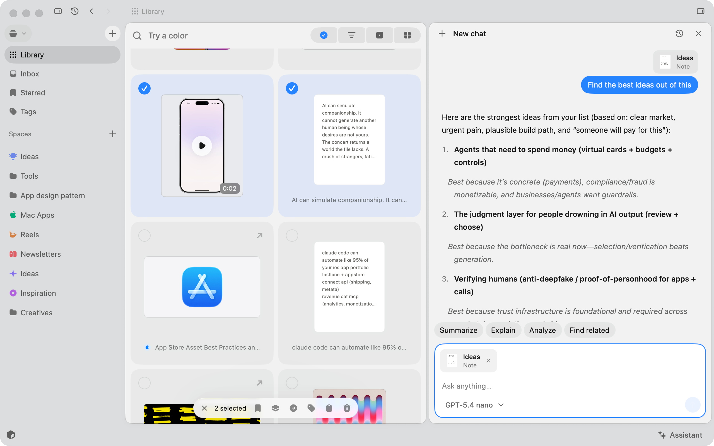
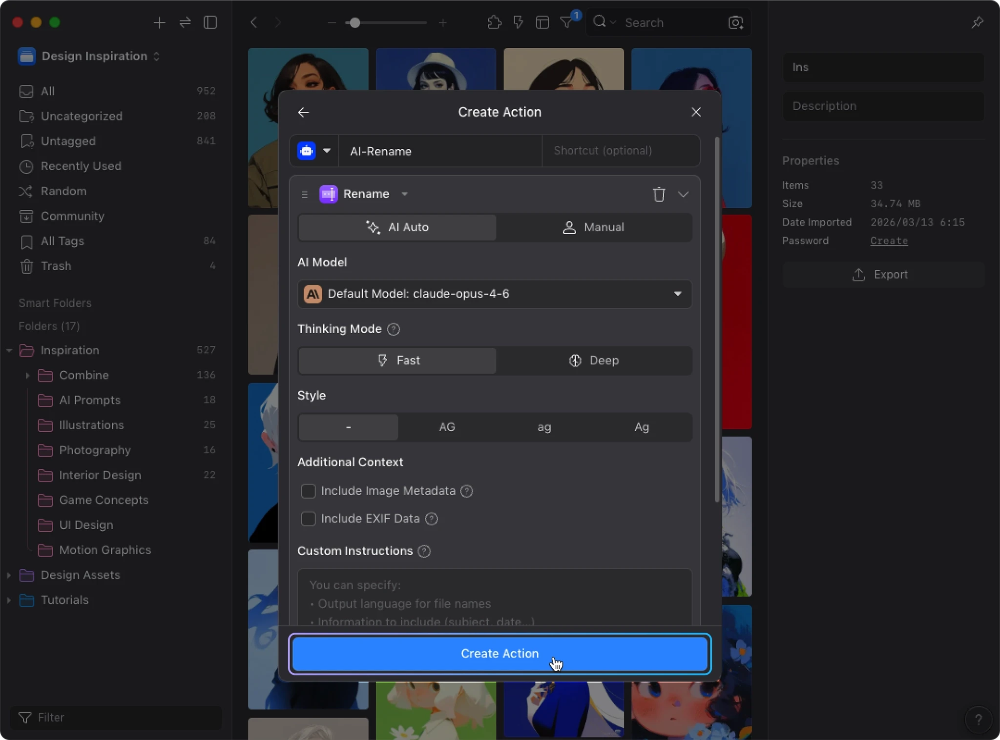
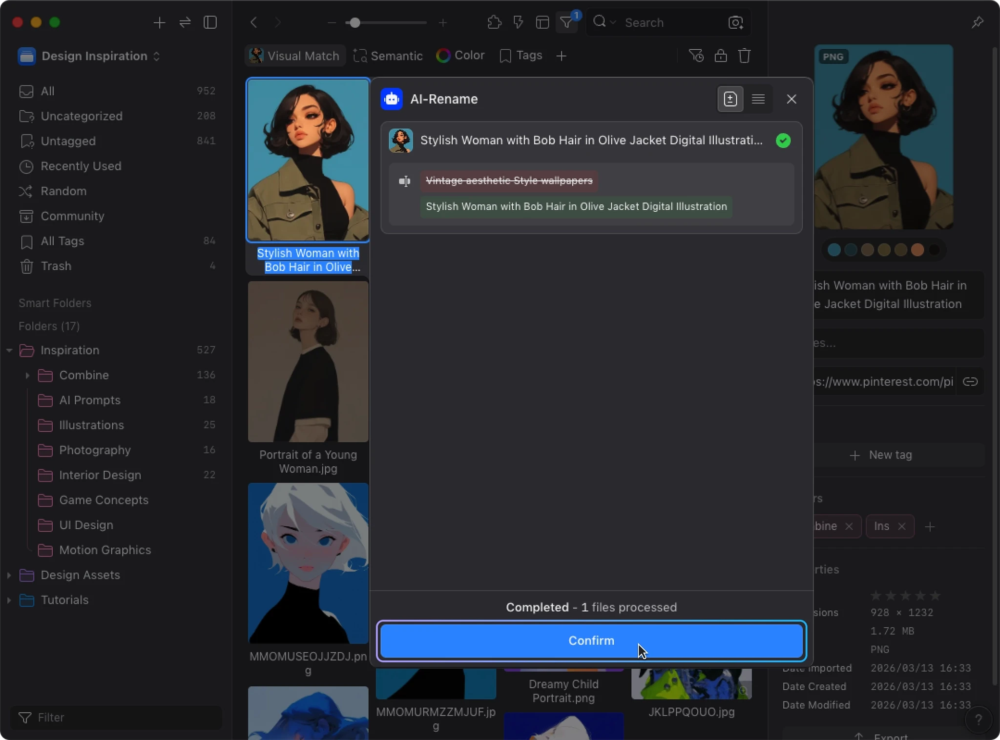

# Resurf and Eagle: Assistant and AI research

Investigated August 30, 2026. Prepared for Pond’s Assistant page and companion pane proposal.

## Conclusion

**Use Resurf to inform conversation context and Eagle to inform controlled actions.** The opportunity for Pond is an Assistant that can explain the library, show the material behind an answer, and propose useful changes without making the interface busy.

This investigation does not recommend reproducing either interface wholesale. Keep the decisions already made for Pond: Assistant as the user-facing name, a page plus companion pane, compact model selection, the animated Pond mark, and no permanent suggestion list or provider footer under the composer.

## Evidence and limits

- **Documented:** described by the product’s own documentation, release notes, or marketplace listing. This establishes a vendor claim, not an independent performance test.
- **Visible:** observed in an official screenshot. This establishes interface anatomy, not hidden behavior or implementation.
- **Planned:** explicitly on a roadmap or described as exploratory.
- **Unverified:** public evidence did not resolve the question. This does not mean the feature is absent.
- **Proposal:** a recommendation for Pond, not a claim about either competitor.

No competitor app was installed, no API keys were supplied, and no private library was connected. AI quality, latency, accessibility, persistence, cancellation, and network behavior were not tested hands-on. Public screenshots and primary sources were inspected. Eagle’s detailed feature and source inventory is in [the Eagle appendix](eagle-ai-source-notes.md).

## The products are doing different jobs

| Area | Resurf | Eagle | Implication for Pond |
| --- | --- | --- | --- |
| Conversation surface | Docked in-app AI pane, shipped with Resurf 2. [R1] | Native conversational Eagle Agent was described as exploratory; separate AI plugins and external-agent connectivity are available. [E1] | Design our own conversation surface around library work. |
| Retrieval | Current ordinary search is full-text/metadata; semantic and visual similarity are explicitly not shipped. [R3] | Separate semantic text-metadata and visual-similarity modes. [E1] | Label what is being searched; do not imply capabilities from a chat box. |
| Model strategy | OpenAI BYOK now; additional providers in progress. [R4] | Shared provider/model hub, including local endpoints. [E3] | Keep configuration in Settings and everyday selection compact. |
| Organizing | AI proposes titles, tags, and Spaces for approval. [R5] | AI Action builds repeatable workflows; MCP exposes broader operations to external assistants. [E2][E4] | Add a reviewable action result, not just a prose promise. |
| External agents | MCP and CLI in progress. [R4] | MCP/Skill plugin is available but remains Beta. [E4] | An external integration is a separate permission surface. |

## Resurf, in depth

### Current product and Assistant

Resurf 2 was released on August 8, 2026 as a native Swift rewrite. Its AI pane sits beside the working library and answers from captures, including saved file contents. The release article says tool calling, vision, and transcription requirements motivated a smaller, OpenAI-only provider offering. It describes proactive rediscovery as a direction for future work. The release does not enumerate an agent tool catalog or establish unrestricted autonomous editing. [R1]

The homepage separately advertises opt-in summaries for articles, links, and PDFs, plus questions across saved context. A supported capture format should not be assumed to have full AI understanding: accepting a video file is not evidence of frame-by-frame analysis. [R2]

### What the actual Assistant screen shows

Source: [Resurf’s published Assistant screenshot][R6]. This is a reference image, not a screenshot of Pond.

Visible anatomy:

1. Library and Assistant occupy adjacent surfaces; selected library cards remain visible.
2. The chat header contains new-chat, history, and close controls.
3. A sent question has a compact attached-note card with a thumbnail, title, and type.
4. The composer shows the same kind of attachment with a remove control.
5. The user message is visually distinct; the answer uses plain paragraphs, numbered points, bold titles, and italic explanations.
6. Four shortcut pills sit above the composer. A model label and dropdown sit within it.

The screenshot does not establish how attachments are added, whether selection automatically changes scope, how sources open, or whether history restores model/context choices. It also does not prove the model dropdown’s complete catalog. These require an interactive trial. [R6]

**Interpretation for Pond:** the useful pattern is continuity of context from draft to sent message. Attachments should not disappear into an invisible prompt after sending. The screenshot’s shortcuts and large rounded surfaces are optional styling, not the essential idea.

### Search, sources, enrichment, and rediscovery

Resurf’s own comparison page says its search covers note/article/PDF text, OCR, transcripts, comments, and metadata. It states that Ask Your Library can show the captures used as sources. Optional AI can suggest titles, tags, and Spaces, but changes require approval. Core capture, OCR, extraction, and ordinary search do not require an OpenAI key. [R5]

The product also has a Resurface widget and Shuffle. These are useful rediscovery features, but their presence does not establish a background reasoning agent, semantic recommendations, or a scheduled Assistant workflow. [R5]

Spaces are many-to-many containers, and stacks offer lighter grouping; these are relevant context structures. Resurf also documents system capture integrations, including Shortcuts and Siri intents. Those integrations should not be conflated with a shipped MCP server. [R7]

### Models, privacy, and costs

The current privacy policy says AI is off by default, requires permission before sending, and uses the customer’s own OpenAI account. It says necessary text/OCR or voice data travels directly to OpenAI, API keys are in Keychain, and image files are not uploaded. Sync is a separate optional private CloudKit path. These are vendor policy statements, not a network audit. [R8]

Two inconsistencies deserve caution:

- The release rationale emphasizes vision, while the privacy policy says image files never upload. The reviewed sources do not explain the exact visual payload or reconcile those statements. Do not assume remote visual analysis of arbitrary image contents. [R1][R8]
- The App Store description says no analytics, while the privacy policy documents optional analytics enabled by default; the App Store privacy disclosure also lists product-interaction data. Avoid repeating an absolute no-telemetry claim. [R8][R9]

Voice capture preserves original audio and a raw transcript alongside the cleaned note. The mobile listing supports on-device or OpenAI transcription; it is not evidence that library chat runs locally. [R9]

The current Mac license page lists a $39 promotional standard license ($49 regular) with two years of updates, or $79 promotional lifetime ($99 regular), for up to two Macs. These are software licenses, not included OpenAI usage. Prices are a dated snapshot. [R10] The Mac free tier is 50 captures/four Spaces, with free unlimited iPhone/iPad apps. [R11]

### What is actually on the roadmap

| Status on the official roadmap | Features |
| --- | --- |
| In progress | Claude/Gemini/OpenAI-compatible providers; official CLI and local MCP for search, capture, reading, organization, and export |
| Planned | Capture reminders; imports/exports from other tools; Safari extension |
| To do | Semantic search; similar captures; product-price extraction |

The roadmap says it is not an exhaustive backlog and priorities may change. In particular, the visible “Find related” shortcut is not evidence that the planned similar-capture retrieval engine has shipped. [R4]

### Remaining Resurf questions

- Does library-wide questioning use lexical search, query rewriting, embeddings, or a mixture? The ordinary search implementation is documented; the full Assistant retrieval algorithm is not.
- Can the user lock a conversation to a Space or explicit selection, and can retrieval expand beyond that scope?
- Are context references persisted per message, and are citations backed by exact excerpts?
- Which mutations are exposed to the Assistant itself versus separate enrichment UI?
- What are the token/context limits, source limits, cost presentation, stop/retry behavior, and history retention?
- Is a full-page Assistant available, or only the demonstrated docked surface?

These are investigation gaps, not negative feature claims.

## Eagle: how its pieces fit together

The detailed appendix covers setup, operation types, retrieval/indexing, model capabilities, MCP tools, and sources. The distinction that matters to this design is **four separate layers**:

1. **AI Search:** local retrieval tools integrated with the library’s search/filter workflow. The visual mode takes an image reference; natural-language matching uses text metadata. Sparse metadata therefore limits the latter. [E1]
2. **AI Models:** a shared configuration service for API keys, model preferences, hosted providers, local Ollama/LM Studio endpoints, compatible services, and custom model identifiers. This is infrastructure, not a chat pane. [E3]
3. **AI Action:** saved, repeatable processing workflows. The documented flow selects files, confirms scope/operations, runs steps, and presents per-file results. Its final Confirm control closes the result screen; the documentation should not be read as guaranteeing all changes remain unapplied until that final click. [E2]
4. **MCP/Skill:** external assistants can operate the library through a Beta plugin. This is broader agency and a broader trust boundary than asking a question inside the app. [E4]

The March AI Search announcement described native Eagle Agent as an early exploration. No later official release establishing a shipped native conversational pane was identified in this investigation. Old references to AI Action as forthcoming must be read against its later release, rather than treated as current status. [E1][E2]

**Interpretation for Pond:** Eagle’s strongest contribution is the transition from an AI answer to an inspectable operation. A chat response saying it renamed 40 files is not an adequate interface for that operation.

### Eagle’s action UI, visually

The editor makes an operation into an editable object: its own name, optional shortcut, step card, AI/manual choice, model, Fast/Deep setting, and opt-in metadata/EXIF context. This belongs in a workflow editor, not permanently inside our composer. [E2]

The results screen pairs a thumbnail with an old/new filename comparison, completion mark, and processed count. It is explicitly a completed result. For Pond, we should distinguish this from a proposed-changes screen and label the final control according to its actual effect. [E2]

## What this means for Pond’s existing implementation

The current working-tree Assistant implementation already exposes `searchLibrary`, `readSave`, `applyFilter`, and `citeSaves` to its model. Search uses literal matching over title, description, author, and URL; reading returns stored metadata/notes/tags. This is not yet proof of document-content RAG or semantic retrieval. The source is work in progress, not a claim about a released Pond build. [P1][P2]

The send input currently carries a chat ID and text. Explicit attachment IDs and immutable per-message context would be a real product/data-model addition, not only a new chip style. Provider options and a cloud-consent check already exist, but model capability should still be checked independently from whether a provider accepts a key. [P1][P3]

The isolated prototype is simulated. Its sample source excerpts, context choices, and per-message consent demonstration must not be mistaken for implemented production guarantees. [P4]

## Recommended design and feature sequence

The following is our proposal, informed by the research; it is not a list of features both competitors already ship.

### 1. Make context tangible

Add thumbnail/title/type chips inside the composer for explicit Saves. Permit removing each attachment and inspecting what will be read. Preserve the chips above the sent message. When more than a few Saves are selected, collapse them into a compact count that opens the full list.

Keep three concepts distinct: **attached Saves**, **allowed search scope**, and **sources actually used**. A user can attach one reference while allowing library-wide research; an answer may use a subset of the retrieved material. A single undifferentiated “context” count cannot explain all three.

Add-to-Assistant should be an explicit action in library selection UI. Merely clicking a different library item should not silently change the draft’s attachments or the meaning of a conversation already in progress.

### 2. Return useful library objects

Answers should include compact Save results, not only paragraphs. Each result needs a recognizable thumbnail/title and an action to open it. A citation should expose the supporting excerpt and return to the same source, not merely select a possibly changing set of grid items.

Allow “Show these in Library” when useful. Preserve a way to clear or restore the previous filter. A page can offer a reading-oriented thread while the companion pane keeps this spatial link to the underlying collection.

### 3. Introduce reviewed changes before broad autonomy

When the Assistant proposes tags, titles, or organization, render a dedicated review block with:

- The exact affected Saves and total count.
- Before/after values grouped by operation.
- Per-item inclusion controls and a clear apply action.
- A truthful distinction between proposed, running, completed, skipped, and failed.
- Undo based on recorded previous values, plus a warning when an operation cannot be reversed.

Do not use cloud-data consent as permission to modify the library. Sending content and applying edits are separate decisions. Also do not label a post-execution summary as a preview.

### 4. Turn successful requests into reusable workflows

After a user has reviewed a useful repeated operation, let them save the instructions as an action. Start with a few operations that have reliable data models: propose tags, improve a title, add a note, or assign an existing folder.

The action definition should record accepted input types, scope, intended output fields, model capability requirements, and approval policy. A reusable action should be reachable from selection UI or a menu; it does not need a permanent row of buttons below every conversation.

### 5. Treat model capabilities and local operation honestly

Keep the compact model picker. Use Settings for provider credentials, custom endpoints, default model choices, and capability checks. A model accepting chat is not sufficient evidence of tool calling, vision, or structured-output reliability.

If an operation requires a capability Minnow lacks, explain that at the moment it matters. Offer a compatible model with explicit data disclosure, or offer a reduced local operation. Never silently route a local task to a cloud provider to make it appear successful.

Expose actual work state rather than private reasoning: searching a scope, reading sources, preparing edits, or applying an approved change. The animated logo can communicate activity, but it should accompany truthful status and an eventual stop/cancel affordance.

### 6. Keep external agents and rediscovery as separate projects

An MCP interface should begin with read-only tools and explicit library scope. Mutation tools need validation and auditability; disabling a tool should remove its callable capability, not only hide its menu item. User prompts embedded in saved pages must remain source data, never become instructions authorizing edits.

Proactive resurfacing should earn its place through a useful explanation of why a Save returned and easy dismissal. Do not describe Shuffle, random recall, semantic neighbors, reminders, and a background agent as the same feature.

## Proposed prototype states to inspect next

| State | Design question |
| --- | --- |
| One attached Save / multiple Saves | Can someone tell exactly what they are sending? |
| Folder scope / whole library | Is the retrieval boundary obvious without a persistent footer? |
| Searching / reading / no useful matches | Is progress truthful, with a useful recovery action? |
| Answer with references | Can a person verify the answer without losing the thread? |
| Proposed changes | Can they reject one edit without rejecting everything? |
| Applying / partial failure / undo | Does the UI describe what actually happened? |
| Model lacks a required capability | Is the alternative clear without an unannounced cloud fallback? |

This would add substance while retaining the cleaner composer. It does not require restoring the removed suggestion rows, provider footer, or keyboard-hint line.

## Primary sources

| Reference | Source and purpose |
| --- | --- |
| [R1] | Resurf 2 announcement, August 8: current Assistant and provider direction |
| [R2] | Resurf homepage: summaries and library questions |
| [R3] | Resurf press kit: explicit current limitations |
| [R4] | Resurf roadmap: in-progress versus planned work |
| [R5] | Resurf’s own mymind comparison, checked August 15: search scope, source references, approval of enrichment |
| [R6] | Official Assistant screenshot: visible interface only |
| [R7] | Resurf’s own Anybox comparison: context organization and system integrations |
| [R8] | Resurf privacy policy: data paths, consent, key storage, analytics |
| [R9] | Developer’s App Store listing: mobile transcription and privacy disclosures |
| [R10] | Live Resurf license page: current offer and update terms |
| [R11] | Resurf download page: free-tier limits |
| [E1] | Eagle AI Search launch, March 17: search modes and native Agent roadmap |
| [E2] | Official AI Action listing and guide: editor, execution, and results |
| [E3] | Official AI Models listing: shared configuration and providers |
| [E4] | Official MCP Server listing and release history: Beta status and external-agent tools |
| [P1] | Pond working-tree chat implementation and exposed tool set |
| [P2] | Pond working-tree retrieval and grid interaction tools |
| [P3] | Pond working-tree provider/key configuration |
| [P4] | Pond prototype README: simulated behavior and scope |

Additional Eagle setup, operation-specific, developer, and security sources are cataloged in the linked appendix.

[R1]: https://resurf.so/blog/resurf-2
[R2]: https://resurf.so/
[R3]: https://resurf.so/presskit
[R4]: https://resurf.so/roadmap
[R5]: https://resurf.so/compare/resurf-vs-mymind
[R6]: https://resurf.so/screenshot-assistant.png
[R7]: https://resurf.so/compare/resurf-vs-anybox
[R8]: https://resurf.so/privacy
[R9]: https://apps.apple.com/us/app/resurf-save-organize/id6782162097
[R10]: https://resurf.so/license
[R11]: https://resurf.so/download
[E1]: https://en.eagle.cool/blog/post/eagle-plugin-ai-search
[E2]: https://community.eagle.cool/plugin/ai-action
[E3]: https://community.eagle.cool/plugin/ai-sdk
[E4]: https://community.eagle.cool/plugin/mcp-server
[P1]: ../../apps/desktop/src/main/core/agent/chat.ts
[P2]: ../../apps/desktop/src/main/core/agent/tools.ts
[P3]: ../../apps/desktop/src/main/core/agent/keys.ts
[P4]: ../../apps/desktop/prototypes/assistant/README.md
