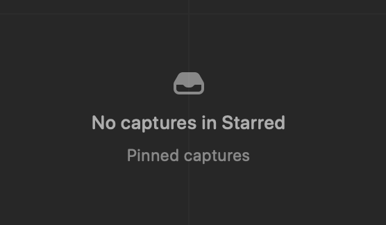
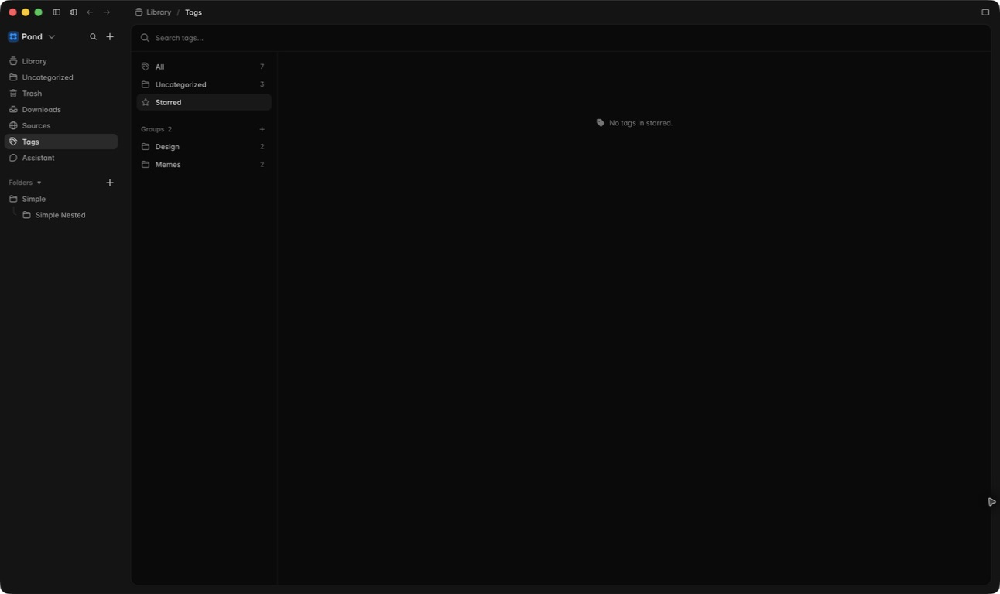
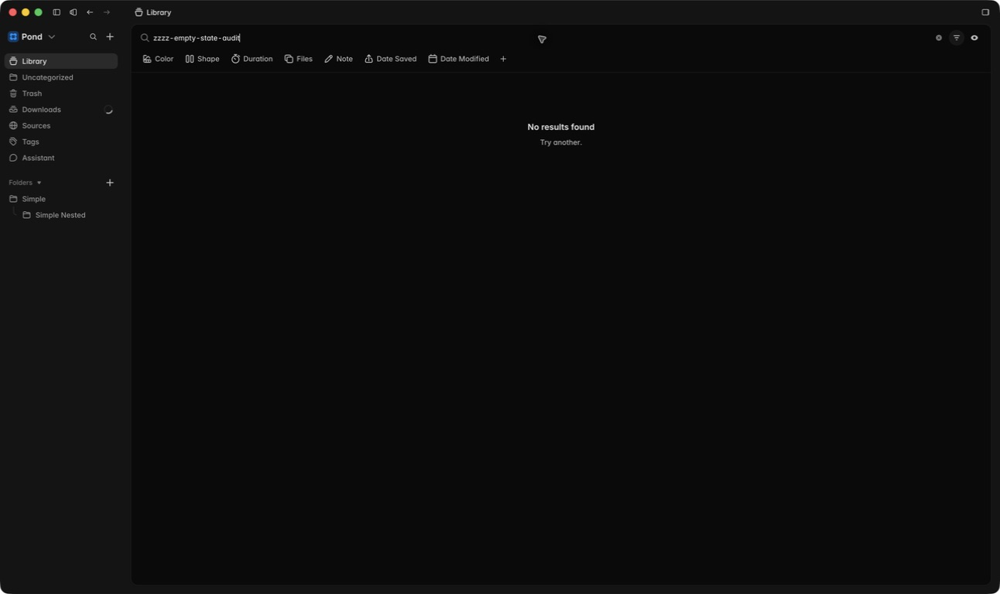
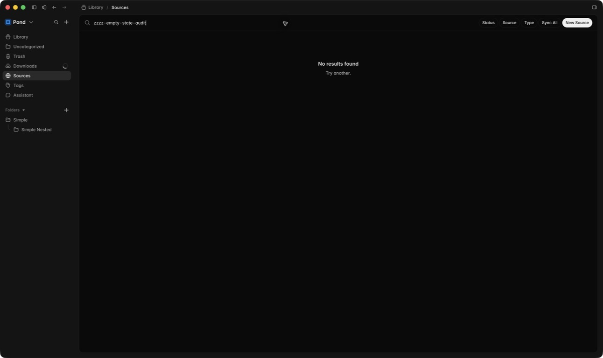
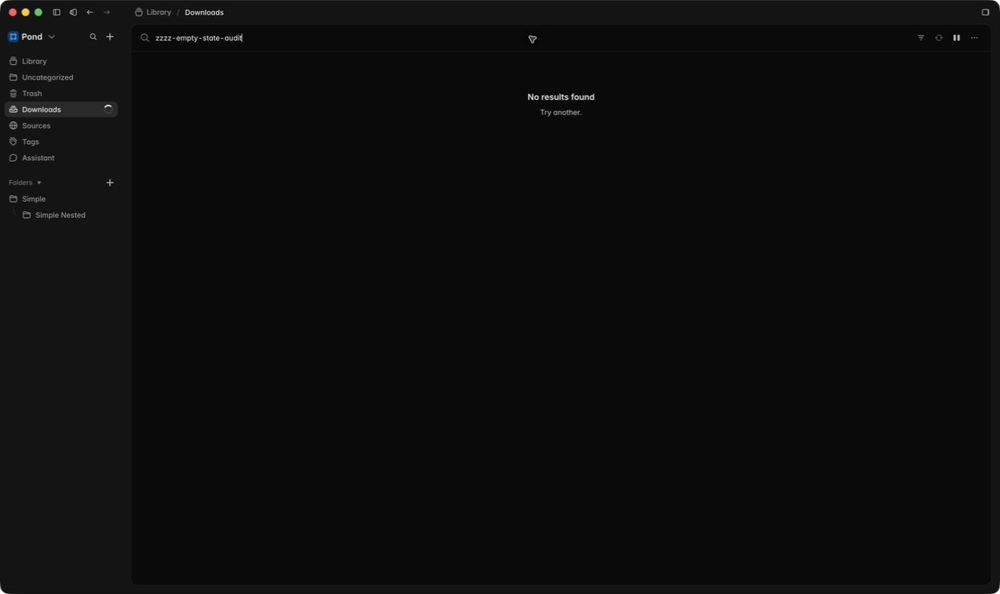
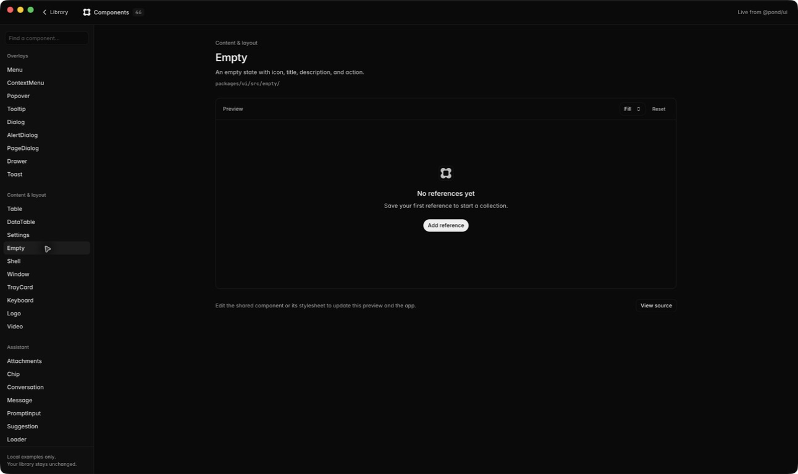
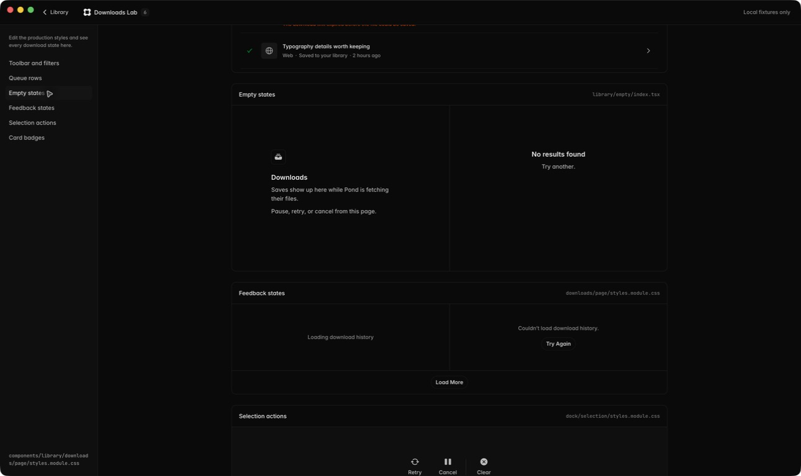

# Empty-state audit

Audit date: 1 September 2026

## Audit scope

This audit covers every production empty-state implementation discoverable in the
desktop renderer, plus the shared `@pond/ui` `Empty` primitive. It uses fresh captures
from the running Electron app and its local component workshops. Development-only
examples are evidence for the shared component, not additional product states.

The desired direction is the supplied centered reference: a quiet bare icon, a
state-specific title, and one secondary line, centered as a single optical group.

## Inventory

### Page and collection states

| State family | Production surfaces | Current implementation |
| --- | --- | --- |
| First-use / truly empty | Library, Sources, Downloads, Trash, Library Tags, Settings Tags | Shared `Empty.Root`, usually `align="start"`, with a shadowed 32px media tile, section-name title, one or two descriptions, and optional actions |
| No search/filter matches | Library, Trash/folders, Sources, Downloads, Library Tags, Settings Tags | Shared `MatchesEmpty`: centered `No results found` + `Try another.`, no icon |
| Empty tag collection | Uncategorized, Starred, named groups | One-off `scopeEmpty`: 16px tag icon + one sentence on a single line |
| Loading-as-empty | Initial Library hydration | Shared `Empty.Root` with spinner, title, description, and polite live-region semantics |

Primary files:

- `apps/desktop/src/renderer/src/components/library/empty/index.tsx`
- `apps/desktop/src/renderer/src/components/library/tags/page/index.tsx`
- `apps/desktop/src/renderer/src/components/settings/tags/index.tsx`
- `packages/ui/src/empty/`
- `packages/theme/src/empty/empty.css`

### Contextual micro-empty states

Nine smaller implementations remain appropriately local to their container: Settings
search, source-target search, tag menus, tag selection, Library filter menus, Assistant
model selection, Assistant conversation selection, Assistant save-reference search, and
the enrichment model picker. These should share copy and color rules, but should not be
forced into the full-page icon/title layout.

## Captured steps

### 1. Tags → Starred — weak

This is the closest semantic match to the reference, but it is the least developed
visually. The icon and sentence form a tiny horizontal status line. There is no title /
secondary hierarchy, the group sits high in a very large canvas, and its `gray-9` color
is visibly quieter than the surrounding navigation. It also bypasses the shared Empty
primitive and lacks the polite status semantics used by filtered empties.

Recommended content shape:

- Title: `No tags in Starred`
- Secondary: `Starred tags appear here.`
- Bare tag/star icon above the title

### 2. Library → no search results — needs refinement

The title/secondary hierarchy is consistent and announced as a polite status update.
However, the group is top-biased rather than optically centered, has no visual anchor,
and the copy is generic. `Try another.` does not say whether the user should change the
search, clear filters, or look elsewhere.

### 3. Sources → no search results — needs refinement

This reuses the same component, which is a strength. The same weak vertical placement
and vague recovery copy remain. The large surrounding table canvas makes the small group
feel accidental rather than intentional.

### 4. Downloads → no search results — needs refinement

Again consistent, but visually indistinguishable from Sources and Library despite the
different task. A search-empty icon can remain generic, but the secondary line should
name the recovery action: `Try a different search or clear the filters.`

### 5. Shared Empty primitive — structurally sound, visually off-direction

The shared primitive already supports the correct semantic structure: media, heading,
description, and optional action. Its default centered mode is closer to the reference.
The shadowed media tile adds unnecessary chrome, and the component relies on large fixed
top/bottom padding instead of centering within its available region. The component has no
shared enter/exit transition, so empty states currently snap into place.

### 6. Full empty vs filtered empty — inconsistent

The side-by-side production specimens expose the system split clearly:

- True empty uses a left-aligned section label (`Downloads`) and two explanatory lines.
- Filtered empty is centered, has no icon, and uses terse generic copy.
- Neither visually matches the supplied centered icon/title/secondary composition.

The distinction between true-empty and filtered-empty should live in copy and actions,
not in alignment or component anatomy.

## Strengths

- Most page-level states already share one composable primitive.
- Titles use real headings, not styled generic text.
- Filtered and loading states use `role="status"` with `aria-live="polite"`.
- Empty screens do not trap the user; global navigation and search remain available.
- The shared primitive already has tokens for width, spacing, type, and color.

## UX risks

1. **Three competing layouts.** Full empty, filtered empty, and scoped Tags empty look
   like unrelated systems.
2. **State labels are often not state descriptions.** `Library`, `Sources`, `Downloads`,
   `Trash`, and `Tags` repeat the page name instead of explaining what is empty.
3. **Recovery copy is too vague.** `Try another.` does not identify the action to take.
4. **Action density is inconsistent.** Some first-use states expose two large buttons;
   Trash offers unrelated `Open Library` and `New Source` actions; other states expose
   none. Passive empties should remain passive, while true first-use states should have
   at most one clear primary action.
5. **Placement feels accidental.** Fixed 72px/96px padding leaves empty content near the
   top of large screens instead of centering it in the available work area.
6. **State changes snap.** The shared primitive and the Tags one-off have no presence
   transition, conflicting with Pond's motion standard.

## Accessibility risks

1. Tags collection empties are plain text rather than a heading/status structure, so the
   scope change may be less clear to assistive technology.
2. The scoped Tags state uses `gray-9`; the screenshot suggests a contrast risk for
   small text. Token contrast should be measured in both themes before implementation.
3. Decorative icons should consistently be hidden from assistive technology while the
   title communicates the state.
4. Any entrance animation must respect reduced motion and must not delay the live-region
   announcement or make content unavailable during the transition.

## Recommended standard

Use one shared page/collection anatomy:

1. Bare contextual icon, without a shadowed tile.
2. State-specific heading: `No saves yet`, `Trash is empty`, `No tags in Starred`, or
   `No results found`.
3. One concise secondary line explaining what appears here or how to recover.
4. Optional single primary action only when the user must act to populate the state.
5. Center the group horizontally and optically within the available content region.

Keep contextual popup/menu empties compact and text-only, but standardize their copy:
`No matches`, `No tags yet`, or `None available` according to the actual state.

The shared component should own the visual and motion behavior. State changes should
animate opacity and a small directional translation with Pond's fast/standard tokens;
the final layout should be available immediately, and reduced motion should skip directly
to it.

## Suggested implementation order

1. Update the shared `Empty` primitive and tokens to the centered reference anatomy.
2. Replace Tags `scopeEmpty` with the shared primitive and add status semantics.
3. Rewrite the six page-level titles/descriptions and reduce first-use actions.
4. Give `MatchesEmpty` a contextual icon and explicit recovery copy.
5. Standardize the nine micro-empty copy/color rules without giving them the page layout.

## Evidence limits

- The current library contains data, so truly empty Library, Sources, Trash, and Tags
  states could not all be reached without destructive data changes. Their production
  structure and copy were audited from code, and the shared production components were
  captured in Pond's local component workshops.
- The audit does not claim WCAG compliance. Keyboard behavior, screen-reader output,
  exact computed contrast, reduced-motion behavior, and responsive zoom still require
  implementation-time testing.
