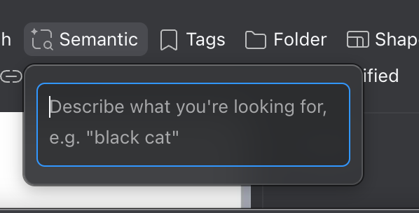
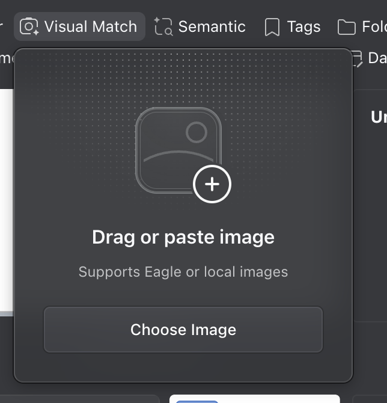

# Eagle AI Search

Research date: 2026-09-03. Question: what Eagle's AI Search actually is, how the two filter-bar modes work, and what Pond already has versus that surface.

Primary sources only for Eagle claims. Pond claims come from this repository. This is not a live Eagle session. Visual Match was not executed against a library. GPU speedup figures are vendor claims, not our benchmarks.

Earlier notes this supersedes for search-specific detail: [Eagle AI source notes](eagle-ai-source-notes.md) (2026-08-30), [filter dropdown investigation](2026-08-31-eagle-filter-dropdowns.md), [Pond vs Eagle gap](2026-09-01-pond-vs-eagle-gap-assessment.md) section 3. Those remain the sources for AI Action, AI Models, MCP, and Agent.

## What it is

Eagle AI Search is an official Eagle 4 plugin. It is not a chat agent and not a replacement for keyword search, tags, or folders. It adds two retrieval modes that sit in the same filter bar as Tags and Folder. [Launch post](https://en.eagle.cool/blog/post/eagle-plugin-ai-search) [Plugin listing](https://community.eagle.cool/plugin/ai-search)

Shipped as an Eagle 4 plugin after the team decided not to hold the work for Eagle 5. Native Eagle Agent was described in the same launch post as an early exploration. No later official Agent release was found in this pass. [Launch post](https://en.eagle.cool/blog/post/eagle-plugin-ai-search)

Listing at inspection: version **1.0.5**, updated **2026-06-17**, 35.8K downloads. Plugin API requires Eagle 4.0 build 18+. The plugin listing does not state a separate app-version floor. [Plugin listing](https://community.eagle.cool/plugin/ai-search) [Plugin API changelog](https://developer.eagle.cool/plugin-api/changelog)

Support pages are Next.js SPAs. HTTP fetchers return the title only. English and Chinese article bodies were recovered from the HTML RSC payload (`self.__next_f`). [Support article](https://en.eagle.cool/support/article/ai-search)

| Version | Date | What changed |
| --- | --- | --- |
| 1.0.0 | 2026-03-17 | Initial release |
| 1.0.1 | 2026-03-20 | Indexing opt-in per library. Sleep memory, index stuck at 98%/99%, sync after enable, leftover processes |
| 1.0.2 | 2026-03-20 | Natural-language results mis-sorted on macOS |
| 1.0.3 | 2026-04-01 | Download memory, corrupt downloads, retry verification, macOS disk-space false negatives |
| 1.0.4 | — | Not listed. Listing jumps 1.0.3 → 1.0.5 |
| 1.0.5 | 2026-06-17 | NVIDIA detection. Wizard could show CPU-only on supported NVIDIA Windows |

## Naming. Official copy and the live chips disagree

Do not mix these labels.

| Surface | Text mode | Image mode |
| --- | --- | --- |
| Launch post, plugin listing, support how-to | Natural Language Search | Reverse Image Search |
| Chinese listing, blog, support | 自然语言搜索 | 以图找图 |
| Homepage AI block | Semantic Search, plus Cross-Source Search | Visual Search |
| Build 21 teaser | Semantic search | Reverse image search |
| MCP changelog | semantic search tools | visual similarity search tools |
| Plugin API and Web API | `searchByText` | `searchByBase64`, `searchByItemId` |
| Live filter bar, 2026-08-31 inspection and 2026-09-03 screenshots | Semantic | Visual Match |

Official written UI strings are **Natural Language Search** and **Reverse Image Search**. No fetched Eagle page uses the exact strings **Semantic** or **Visual Match**. The running app does. Treat the screenshots as the live chrome, and the support article as the documented chrome. [Launch post](https://en.eagle.cool/blog/post/eagle-plugin-ai-search) [Support article](https://en.eagle.cool/support/article/ai-search) [Screenshot](assets/eagle-ai-search/semantic-filter.png)

Homepage "Cross-Source Search" is not this plugin. Eagle 5 teasers that mention searching Eagle plus Pinterest, Unsplash, and Google are also not this plugin. [Homepage](https://en.eagle.cool/)

Pond already uses **Natural-Language Search** for a different feature: compiling a sentence into structured filters (`nlCompiler`). Eagle's text mode is embedding similarity. If Pond copies the chip, do not reuse that Settings title.

## Product surface

Both modes are pin-able filter categories. Keyword search stays in the search bar. The launch post is explicit: AI Search complements folders, tags, and keyword search. It does not replace them. [Launch post](https://en.eagle.cool/blog/post/eagle-plugin-ai-search)

The `+` control adds a category to the filter bar's quick-access area. Hiding the toolbar keeps active filters. That matches Pond's existing pin model in `filter-menu`. [Filter dropdown investigation](2026-08-31-eagle-filter-dropdowns.md)

### Semantic

Chip: sparkle magnifier, label **Semantic**, sits beside Tags, Folder, Shape. Popover is a single focused text field. Placeholder: `Describe what you're looking for, e.g. 'black cat'`.

Official enable steps: `+` → **Natural Language Search** → type a description. Pin for later. Support does **not** put this mode on a search-bar button. That extra control is documented only for reverse image search. [Launch post](https://en.eagle.cool/blog/post/eagle-plugin-ai-search) [Support article](https://en.eagle.cool/support/article/ai-search)

The `black cat` placeholder is from the live popover. It is not in official copy. Build 12's `(cat OR dog) black` example is ordinary keyword search, not this plugin. [Eagle 4 Build 12](https://en.eagle.cool/blog/post/eagle4-build12)

Direct inspection on 2026-08-31: a query became an active clause. Result count stayed 217. Model readiness was not established. That observation does not prove ranking-without-filter, and it does not prove a no-op. It only proves the chip can be active without an obvious count change. [Filter dropdown investigation](2026-08-31-eagle-filter-dropdowns.md)

### Visual Match

Chip: camera with sparkle, label **Visual Match**. Popover: drop zone, plus badge on a placeholder image, title **Drag or paste image**, subtitle **Supports Eagle or local images**, button **Choose Image**.

Official copy documents two starts, plus a filter-bar pin:

1. Button to the **right of the search bar**. Drag a library image onto it.
2. Copy an image (support names `Ctrl+V` / `⌘+V`, including from a browser), click that button, paste.
3. Filter `+` → pin **Reverse Image Search**.

Official copy does **not** mention Choose Image, a drop zone, URL input, a similarity slider, or "Supports Eagle or local images." The running filter popover does. [Launch post](https://en.eagle.cool/blog/post/eagle-plugin-ai-search) [Support article](https://en.eagle.cool/support/article/ai-search) [Screenshot](assets/eagle-ai-search/visual-match-filter.png)

The developer API explains the three query shapes the UI is covering:

| UI input | API |
| --- | --- |
| Type a description | `searchByText(query, { limit })` |
| Paste or Choose Image (bytes) | `searchByBase64(base64, { limit })` |
| Drag a library item | `searchByItemId(itemId, { limit })` |

Default `limit` in the plugin API is 20. Results are `{ item, score }` with `score` in 0–1. The official example keeps `score > 0.5`. That threshold is sample code, not a documented product slider. [Plugin AI Search module](https://developer.eagle.cool/plugin-api/extra-module/ai-search) [Web API](https://developer.eagle.cool/web-api/api/ai-search)

No image was submitted in the 2026-08-31 session. Accuracy sliders, live-update while dragging, and whether Visual Match ANDs with Tags were not tested. [Filter dropdown investigation](2026-08-31-eagle-filter-dropdowns.md)

## What each mode matches

This is the load-bearing product claim, and Eagle's own docs conflict.

### Launch, listing, and support (English and Chinese)

Support FAQ, recovered from the RSC body:

> Reverse Image Search: Finds assets based on visual similarity
> Natural Language Search: Finds assets based on their existing text information

And, in bold on the support page:

> AI Search's Natural Language Search works by matching against the text information already associated with your assets — it does not directly analyze or understand the visual content of images.

Launch: filenames, descriptions, notes, other searchable fields. "Rather than analyzing image content directly through visual understanding." Random names (`IMG_4821.jpg`, `Screenshot 2024-11-15 at 3.45.12 PM.png`) give it little to retrieve. Not designed for complex logical query conditions. Cross-language is within existing text metadata, not image understanding. CLIP is never named. [Launch post](https://en.eagle.cool/blog/post/eagle-plugin-ai-search) [Support article](https://en.eagle.cool/support/article/ai-search) [Chinese launch](https://cn.eagle.cool/blog/post/eagle-plugin-ai-search)

Build 21 teased "sunset on a beach" as AI understanding meaning. The March 17 launch walked that back for the text mode. [Build 21](https://en.eagle.cool/blog/post/eagle4-build21)

### Developer APIs

`searchByText` is "Search for related images using natural language descriptions." The Web API sentence is stronger: "The AI model finds **visually or semantically** matching items." Examples are `an orange cat`, `sunset beach scenery`, `一只橘色的猫咪`. Those read like content queries. Treat that Web API sentence as an overclaim against launch and support until a live test says otherwise. [Plugin AI Search module](https://developer.eagle.cool/plugin-api/extra-module/ai-search) [Web API](https://developer.eagle.cool/web-api/api/ai-search)

The live placeholder `black cat` also reads like content search. No live retrieval test was run, so the engine behind `searchByText` is still unverified. Pond should not copy the metadata-only limitation either way. Pond already stores captions, OCR, transcripts, text embeddings, and CLIP image vectors. Wiring Semantic to those is a product advantage, not a fidelity requirement.

## API contract

Added 2026-01-09 for Eagle 4.0 build 18+. Local HTTP is `http://localhost:41595`. [Plugin API changelog](https://developer.eagle.cool/plugin-api/changelog) [Web API](https://developer.eagle.cool/web-api/api/ai-search)

Status:

- `isInstalled`, `isReady`, `isStarting`, `isSyncing`
- `open()` prompts install if missing
- `checkServiceHealth`
- `getSyncStatus` → `{ isSyncing, syncedCount, totalCount, progress }`

Search:

- `searchByText(query, { limit })`
- `searchByBase64(base64, { limit })`
- `searchByItemId(itemId, { limit })`

Recommended client flow: installed → ready (poll if starting) → sync status → search. Results are ranked lists with a cap, not boolean predicates. That is the important engine fact for Pond's filter schema.

`item` in plugin results is a full Eagle Item. Callers can `save()` it. Pond should return Save IDs, not mutate from search.

## Indexing, hardware, privacy, cost

Analysis and retrieval are advertised as local and offline. No asset upload. No per-search fee after plugin install. First install still downloads models, so it needs a network once. [Launch post](https://en.eagle.cool/blog/post/eagle-plugin-ai-search)

Support FAQ still says: "Each library has its own independent index. The first time you open a new library, the system will automatically build an index for it." Changelog **1.0.1**, three days after 1.0.0: "Indexing is no longer enabled automatically by default — users can now choose which libraries to index." Chinese support matches the stale automatic claim. Treat **opt-in per library** as current unless a later doc reverses 1.0.1. [Support article](https://en.eagle.cool/support/article/ai-search) [Plugin listing changelog](https://community.eagle.cool/plugin/ai-search)

Setup wizard, from support: Plugin Introduction → Download AI Models (hardware-detected build) → first launch and index for the current library. Model names, sizes, and on-disk index path are unpublished. [Support article](https://en.eagle.cool/support/article/ai-search)

Sync status is `{ isSyncing, syncedCount, totalCount, progress }`. Homepage "Cross-Source Search" is a different, undocumented-in-plugin feature. [Web API `getSyncStatus`](https://developer.eagle.cool/web-api/api/ai-search)

Hardware matrix from the launch post:

| Environment | Mode |
| --- | --- |
| Windows + NVIDIA | GPU or CPU. GPU recommended |
| Windows + AMD / Intel GPU | CPU only, currently |
| Mac Apple Silicon | GPU, on by default |
| Mac Intel | CPU only |

Vendor claim: 30–50× faster with GPU. Setup wizard picks a build. Changelog later fixed NVIDIA detection and a wizard that showed CPU-only on supported NVIDIA GPUs. [Launch post](https://en.eagle.cool/blog/post/eagle-plugin-ai-search) [Plugin listing changelog](https://community.eagle.cool/plugin/ai-search)

Other changelog themes, useful as onboarding states: corrupt/incomplete model downloads, macOS disk-space false negatives, NL results mis-sorted on macOS, indexing stuck at 98–99%, sync broken after enabling indexing, processes that survive quit, memory after sleep. [Plugin listing changelog](https://community.eagle.cool/plugin/ai-search)

No public model name, parameter count, VRAM floor, or on-disk index path was found. A generic "AI plugin stuck at model initialization" article mentions less than 4 GB RAM. It is not named as AI Search. AI Action's 12 GB VRAM note is a different plugin. Do not copy either number onto this feature. [Stuck at initialization](https://en.eagle.cool/support/article/ai-plugin-stuck-at-model-initialization) [AI Action listing](https://community.eagle.cool/plugin/ai-action)

## Adjacent products. Do not collapse them

**AI Action** writes names, descriptions, folder membership, and tags. Install AI Search first if you plan to use AI Tags or AI Folders: the visual index improves classification. Search finds. Action fills metadata so later text queries have something to match. AI Action uses the separate **AI Models** hub (cloud or local vision). No fetched AI Search doc says Search uses that hub. [AI Action launch](https://en.eagle.cool/blog/post/eagle-plugin-ai-action) [AI Action listing](https://community.eagle.cool/plugin/ai-action)

**MCP Server** (Beta, listing v0.3.1, 2026-05-19). Changelog v0.2.0 (2026-03-01, before Search shipped) added preview semantic and visual-similarity tools, "Requires the upcoming AI Search plugin." That "upcoming" line is stale after 2026-03-17. The MCP support article does not document those tools or their IDs. Endpoint in support: `http://127.0.0.1:41596/mcp`. [MCP listing](https://community.eagle.cool/plugin/mcp-server) [MCP support](https://en.eagle.cool/support/article/eagle-mcp-server)

**Pinterest Visual Search** and **Reverse Image Search** in the plugin directory are web reverse-image tools. They are not local AI Search. Pond's `reverseImageSearch` in `apps/desktop/src/renderer/src/lib/save/reverse-image-search.ts` is that web pattern (Google Lens, Yandex, Bing, TinEye). It is not Visual Match.

**Eagle Agent** remains unreleased in examined sources.

## Pond inventory

Pond already has more retrieval machinery than Eagle's marketing description of Semantic. Almost none of it is on the Library filter bar.

### Library grid today

Pipeline in `useNarrowedSaves`:

1. If the search bar has text, `useSearchResults` → `saves.searchFts` (FTS5). Otherwise the full pool.
2. Nav / folder / mode filters.
3. Boolean `matches(filterQuery, save)` in `useFilteredSaves`.

FTS columns: title, description, author, tag_names, caption, ocr_text, transcript, notes, url. Porter tokenizer. [db.ts FTS](../../apps/desktop/src/main/db.ts)

OCR is in FTS and in the text-embedding payload. It has no filter `FieldId`. Caption and transcript do (`exists` / contains).

Default Library sort keeps FTS BM25 order. Changing sort in the grid drops that ranking and reorders the filtered set. [use-filtered-saves.ts](../../apps/desktop/src/renderer/src/hooks/use-filtered-saves.ts)

The grid never reads `embedding` or `clipEmbedding`. Semantic Search and Visual Similarity being on in Settings does not change Library ranking. `ai` prefs are per-library (`POND_PREF_KEYS`). Enrichment runs in the renderer, one at a time, paused while hidden.

### Filter bar today

Pin-able categories, `+` customize, Clear Filters, hide-preserves-active. Same chrome Eagle uses for Semantic / Visual Match. Registered `FieldId`s are boolean or range predicates. Semantic and Visual Match are not fields. [fields/index.ts](../../packages/schema/src/filters/fields/index.ts) [toolbar-state.ts](../../apps/desktop/src/renderer/src/components/library/filter-menu/toolbar-state.ts) [2026-08-31 notes](2026-08-31-eagle-filter-dropdowns.md)

`PredicateValue` cannot store a reference image or a ranked ID list. `matches()` cannot express cosine similarity. Cramming these into `FieldId` would be the wrong schema move.

Closest existing editor: `ContentFilter` (presence plus a contains field). Semantic's popover is closer to that than to Tags. Visual Match has no analog.

### Settings. Three switches, three jobs

From `config-enrichment.tsx` and `packages/schema/src/prefs.ts`:

| Pref | Settings title | What it actually does |
| --- | --- | --- |
| `nlCompiler` | Natural-Language Search | Turns a sentence into filter predicates via the Agent model. Not embedding search. |
| `semanticSearch` | Semantic Search | Copy: "Rank results by meaning." Builds text embeddings. Agent retrieval can rank by them. The grid does not. Also gates NL facet resolve (`resolveFacets`) and suggested tags. |
| `enableClip` | Visual Similarity | Copy: "Find similar images and duplicates." Builds CLIP image embeddings. Agent retrieval can rank images from a **text** CLIP query. There is no Library similar-image chip. Duplicates are sha256 / phash groups, not CLIP. |

Defaults: MiniLM `Xenova/all-MiniLM-L6-v2`, CLIP `Xenova/clip-vit-base-patch32`. Both off until toggled. [embeddings.ts](../../apps/desktop/src/shared/embeddings.ts)

Pond "Natural-Language Search" ≠ Eagle "Natural Language Search". Enter in the search bar runs `compileAsk`: Stage A predicates, optional embedding facet resolve, optional Agent plan. Residual text still goes through FTS. That path produces filters. It does not rank the grid by meaning.

Pond "Semantic Search" is closer to Eagle Semantic, but it is an index switch, not a filter chip. Pond "Visual Similarity" is closer to Eagle Visual Match, but there is no drop/paste/choose query. Settings copy currently overclaims both.

### Indexes Pond already builds

Text embeddings (`textEmbedding` enricher): title, description, notes, author, tags, plus caption, OCR, transcript when present. Eligible when `semanticSearch` is on. [text-embedding.ts](../../apps/desktop/src/renderer/src/lib/enrichment/enrichers/text-embedding.ts)

CLIP image embeddings (`clip` enricher): representative image only, stored as `clipEmbedding` + `clipModel`. Eligible when `enableClip` is on. [clip.ts enricher](../../apps/desktop/src/renderer/src/lib/enrichment/enrichers/clip.ts)

Captions, OCR, and transcripts also land in FTS, so keyword search already sees enrichment text. Eagle Semantic, if the marketing claim is true, does not get that unless AI Action wrote a description.

Duplicates use `phash` / sha256 (`saves.findDuplicates`). That is exact-ish duplicate grouping, not visual similarity search. `saves.setPhash` has no in-repo callers, so perceptual hash is often empty and the menu falls back to file hashes. Color swatch "Find Similar Color Items" writes a `color near` filter. It is not CLIP.

### Agent and MCP already do hybrid retrieval

`retrieveLibrary` in `library-retrieval.ts`:

1. FTS candidate list.
2. Optional text-dense cosine against `saves.embedding` when `semanticSearch` is on.
3. Optional visual-dense cosine against `saves.clipEmbedding` when `enableClip` is on. The **query** vector is CLIP **text**, from `CLIPTextModelWithProjection`, not an image.
4. Reciprocal-rank fusion. Scope and media filters are hard constraints.

Callers: Agent `searchLibrary`, MCP `search_library`. Tests inject vectors and never download models. [library-retrieval.ts](../../apps/desktop/src/main/core/library-retrieval.ts) [query-embeddings.ts](../../apps/desktop/src/main/core/query-embeddings.ts) [mcp.ts](../../apps/desktop/src/main/core/agent/mcp.ts)

Gaps versus Eagle Visual Match:

- No `searchByBase64` path. Query encoding is text-only.
- No `searchByItemId` path in the Library UI. Stored CLIP vectors exist. Nothing accepts a Save ID or dropped file as the query.
- Query CLIP runs on WASM in the main process (`device: "wasm"`). Image CLIP in the renderer can use WebGPU. Two runtimes.

The assistant plan already named this hybrid path as Task 6. It is implemented for Agent. It is not implemented for the grid. [2026-09-01 assistant plan](../superpowers/plans/2026-09-01-provider-independent-library-assistant.md)

## Gap, compressed

| Eagle chip | Eagle engine | Pond engine | Pond surface |
| --- | --- | --- | --- |
| Semantic | `searchByText`, marketing: metadata embeddings. API: maybe visual too | Text embeddings over metadata **and** captions/OCR/transcripts, plus CLIP text→image in Agent | Settings switch. Search bar is FTS. No filter chip |
| Visual Match | `searchByBase64` / `searchByItemId` | CLIP image vectors stored. No image-query encoder in retrieval | Settings switch, Find Duplicates (phash), web reverse-image menu. No drop/paste/choose chip |

Pond's missing work is the filter-bar query UI and a rank overlay on the grid. The indexes and most of the math exist.

Keep **Agent** as the right-column chat. Do not move conversation into the filter bar, and do not turn Agent into a Semantic search field. Eagle split these on purpose: AI Search finds, MCP/Agent (unreleased there) talks. Pond already has the chat surface Eagle does not ship. Semantic and Visual Match narrow the grid. Agent answers, cites, and acts on that grid.

## How Pond should have it

Research conclusion, not an implementation plan.

**Two surfaces.** Filter bar finds. Agent pane chats. They share `retrieveLibrary`. They do not share UI.

| Surface | Job | Not |
| --- | --- | --- |
| Filter chips | Rank or restrict the Library by meaning or look. Combine with Tags and Folder. Instant, no model key | A composer, a thread, or a substitute for Agent |
| Search bar | Keyword FTS, plus `nlCompiler` turning a sentence into filters | Semantic ranking |
| Agent (right column) | Conversation over the Library. Search, cite, explain, apply filters. Your key or local host | A second Semantic chip |

**Put both find modes on the filter bar.** Same pin/`+`/clear chrome as Tags. Semantic editor: one field, placeholder in the Eagle shape (`Describe what you're looking for`). Visual Match editor: drag a Save, paste, Choose Image. Map those inputs to the three Eagle API shapes: text, bytes, Save ID.

Agent can still call the same retrieval when a question needs Saves. If a Semantic or Visual Match chip is active, that overlay is the default Agent scope, the way folder context already is. The pane stays a thread.

**Keep them off the boolean filter schema.** Store an overlay on the view: a semantic string and/or a visual reference. After nav + FTS + `matches()`, rank or restrict with cosine search. Eagle's own API is a scored `limit` list, not SQL.

**Do not make Semantic metadata-only.** Use the text embedding (captions included) and CLIP text→image. That is how Pond's Agent already searches, and it is how `black cat` should work on unlabeled photos. Eagle may not do that. Pond should.

**Reuse `retrieveLibrary`, do not fork it.** Semantic and a first Visual Match slice can call the existing text and CLIP-text channels (Agent already fuses them). True Visual Match still needs an image-query channel (`searchByBase64` / `searchByItemId`): encode a probe with `CLIPVisionModelWithProjection` and cosine against stored `clipEmbedding`. That path does not exist today. Library grid, Agent, and MCP should share both.

Do not overload `compileAsk` or boolean `FieldId`s for ranking. Keep the chips as retrieval overlays beside FTS and filters.

## Locked 2026-09-03. What Pond ships

This supersedes the "gap" and "how Pond should have it" sections above for product decisions. Eagle research above stays.

**Settings stay two pages.** Search (`ai`) is on-device indexes: Semantic Search, Visual Similarity, captions, OCR, transcripts. Models (`agent`) is BYOK / Ollama / LM Studio for Agent. Do not merge them. Named DeepSeek/Qwen rows stay out. Compatible covers custom endpoints.

**Chip overlay contract.** Semantic and Visual Match are not `FieldId`s. They live on view-store as `semanticQuery` and `visualProbe`. After nav + FTS + boolean filters, `saves.retrieve` ranks and restricts with sqlite-vec (`save_text_vec` 384, `save_clip_vec` 512). Saves without the needed vector drop out. Clear Filters clears overlays. Index off: chips still appear in `+`; opening one sends you to Settings Search.

**Labels.** Chip: Semantic, Visual Match. Settings titles: Semantic Search, Visual Similarity. Never call a chip Natural-Language Search. `nlCompiler` owns that.

**Cursor for this Library.** Agent is the right column. Default scope is Library. Folder nav, selection/"these", attachments, and active chips are the working set. Writes are propose → diff → Apply → Undo. No silent `executeTransaction` from the model. Admin stays out: factory reset, switch library, disconnect accounts, API keys.

**Power inventory vs Cursor.** grep → `grepLibrary` (FTS). read_file → `readSave` with offset/limit over caption/OCR/transcript/notes/comments. list_dir → `libraryOverview`. open → `openSave`, `applyFilter`, `setOverlay`, `citeSaves`. edit → `proposeChanges` (metadata, folders, tags, rating, trash, saved views, import, export, sync, refresh, archive, reveal, batch rename, purge with forever copy). images → CLIP ranks the grid; the chat model sees pixels when `prefs.agent.visionModel` has vision. Cmd-K Save search uses `saves.retrieve` when Search indexes are on.

**MCP.** `search_library` accepts visual probes. `read_save` returns stored text. `grep_library` and `apply_filter` exist. Writes stay in-app review.

**Settings stay the index switches.** If Semantic Search or Visual Similarity is off, the chip points at Settings rather than failing silently. Eagle makes the whole plugin opt-in per library. Pond already makes each enricher opt-in.

**Do not call the chip Natural-Language Search.** That name is taken by `nlCompiler`. Eagle's live chips say Semantic and Visual Match. Official copy says Natural Language Search and Reverse Image Search. Pond Settings already says Semantic Search and Visual Similarity. Prefer those.

**Do not confuse Visual Match with web reverse image search.** Keep Lens/Yandex/Bing/TinEye as an item action. Visual Match stays inside the Library.

**Index states to design for**, from Eagle's changelog: first download, GPU vs CPU, per-library off, stuck progress, quit-while-indexing, coverage (`syncedCount` / `totalCount`). Pond already has enrichment status. Surface coverage on the chip when the index is empty or stale.

## What this investigation did not establish

- Whether Semantic / Visual Match hard-filter the grid, reorder it, or cap it at `limit` (default 20).
- Whether `searchByText` uses a visual encoder despite marketing.
- Model identity, size, download bytes, index file location.
- File-type matrix for visual indexing. Storing a format ≠ embedding it.
- Accuracy / threshold UI. None in the screenshots. Sample code uses 0.5.
- AND semantics with Tags, Folder, and the current folder scope.
- Drag-to-search-bar versus filter-bar Visual Match: one engine or two entry points.
- Whether Choose Image can pick multiple files.
- Live quality of `black cat` on an untagged library.

A short live session would settle the filter-versus-rank question: apply Semantic in a folder with a known count, submit `black cat`, record whether the count drops and whether sort order changes.

## Sources

Eagle:

- [AI Search launch](https://en.eagle.cool/blog/post/eagle-plugin-ai-search)
- [Chinese launch](https://cn.eagle.cool/blog/post/eagle-plugin-ai-search)
- [Plugin listing and changelog](https://community.eagle.cool/plugin/ai-search)
- [Plugin extraModule.aiSearch](https://developer.eagle.cool/plugin-api/extra-module/ai-search)
- [Web API /api/v2/aiSearch](https://developer.eagle.cool/web-api/api/ai-search)
- [Plugin API changelog, 2026-01-09](https://developer.eagle.cool/plugin-api/changelog)
- [AI Action launch](https://en.eagle.cool/blog/post/eagle-plugin-ai-action)
- [MCP plugin listing](https://community.eagle.cool/plugin/mcp-server)
- [Support article](https://en.eagle.cool/support/article/ai-search) (SPA; body recovered from RSC)
- [Chinese support](https://cn.eagle.cool/support/article/ai-search)
- [Homepage](https://en.eagle.cool/)
- [Build 21 teaser](https://en.eagle.cool/blog/post/eagle4-build21)
- [MCP support](https://en.eagle.cool/support/article/eagle-mcp-server)

Pond, this repo:

- [library-retrieval.ts](../../apps/desktop/src/main/core/library-retrieval.ts)
- [query-embeddings.ts](../../apps/desktop/src/main/core/query-embeddings.ts)
- [use-narrowed-saves.ts](../../apps/desktop/src/renderer/src/hooks/use-narrowed-saves.ts)
- [use-search-results.ts](../../apps/desktop/src/renderer/src/hooks/use-search-results.ts)
- [filter-menu](../../apps/desktop/src/renderer/src/components/library/filter-menu/)
- [config-enrichment.tsx](../../apps/desktop/src/renderer/src/lib/settings/config-enrichment.tsx)
- [clip enricher](../../apps/desktop/src/renderer/src/lib/enrichment/enrichers/clip.ts)
- [text-embedding enricher](../../apps/desktop/src/renderer/src/lib/enrichment/enrichers/text-embedding.ts)
- [reverse-image-search.ts](../../apps/desktop/src/renderer/src/lib/save/reverse-image-search.ts)
- [use-filtered-saves.ts](../../apps/desktop/src/renderer/src/hooks/use-filtered-saves.ts)
- [compile-ask.ts](../../apps/desktop/src/renderer/src/lib/search/compile-ask.ts)

Local captures from this conversation: [semantic-filter.png](assets/eagle-ai-search/semantic-filter.png), [visual-match-filter.png](assets/eagle-ai-search/visual-match-filter.png).
