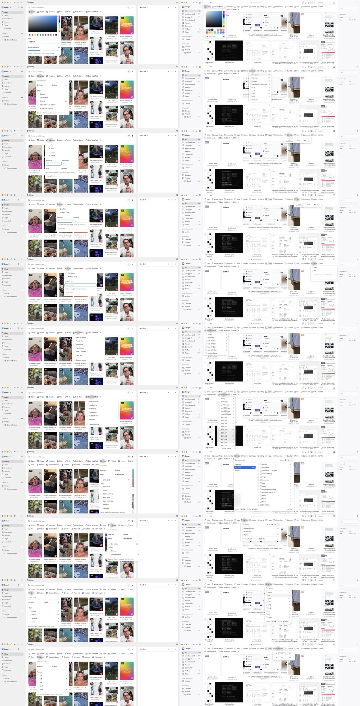
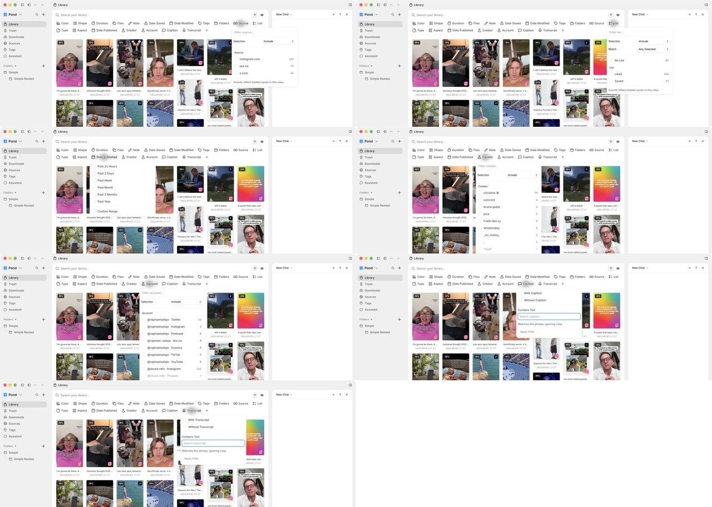

# Pond vs Eagle filter dropdown audit

Date: 2026-09-01

## Scope

Live comparison of every Pond library filter with the closest Eagle filter at the same application viewport. Pond filters with no honest Eagle equivalent are reviewed separately. The original Pond toolbar configuration was restored after capture.

## Evidence

- `pond-vs-eagle-matched.jpg`: paired overview; Pond is always left, Eagle is always right.
- Pair order: Color, Shape, Duration, Files vs Size, Note, Date Saved vs Date Imported, Date Modified, Tags, Folders, Type, Aspect vs Dimensions.
- `pond-only-filters.jpg`: Source, List, Date Published, Creator, Account, Caption, Transcript.
- Full-resolution source captures and individual pairs are stored beside this report.

## Verdict

Pond has the stronger explicit model: named selection modes, Any/All matching, counts, clearer field labels, and better exposed accessibility names. Eagle has the stronger interaction shape: content-sized popovers, less repeated chrome, immediate choices, and a much smaller footprint over the library.

The target should be Eagle's density and task-specific sizing while preserving Pond's explicit include/exclude and matching semantics.

## Exhaustive comparison

| Pond filter | Closest Eagle filter | Health | Finding |
| --- | --- | --- | --- |
| Color | Color | Mixed | Pond adds useful tolerance control, but the 300px panel and full-width picker are much larger than Eagle's compact palette. |
| Shape | Shape | Needs work | Six common choices do not need search, a selection-mode row, and a repeated count disclaimer. Eagle presents the choices directly. |
| Duration | Duration | Needs work | Pond combines presets, two bounds, unit selection, helper copy, and Apply in one tall form. Eagle keeps the range on one compact row. |
| Files | Size (not equivalent) | Needs work | No exact Eagle match. Pond's two presets plus min/max form is visually heavy for a file-count rule. |
| Note | Note | Mixed | Pond's existence choices and text match are more capable; Eagle's Yes/No panel is substantially faster to scan. |
| Date Saved | Date Imported | Mixed | Preset lists align well. Pond is cleaner for common relative dates; Eagle also exposes historic date buckets. |
| Date Modified | Date Modified | Mixed | Same pattern as Date Saved; Pond is compact until Custom Range opens. |
| Tags | Tags | Needs work | Pond exposes Include/Exclude and Any/All clearly, but Eagle's two-pane picker makes selected groups, long tag lists, and counts easier to navigate. |
| Folders | Folder | Mixed | Pond's semantics are clearer, while Eagle removes the selection/match setup and gets users to the folder list faster. |
| Type | Types | Mixed | Pond groups broad media families; Eagle lists exact extensions. These are different useful levels and should not be forced into one model. |
| Aspect | Dimensions | Needs work | They are only partial equivalents. Pond offers common ratios; Eagle offers numeric width/height bounds. Both should remain distinct concepts if Pond later adds dimensions. |
| Source | None | Mixed | Useful Pond-only metadata filter; it inherits the same oversized choice-menu shell. |
| List | None | Mixed | Useful Pond-only filter; short options do not justify the search/control scaffolding. |
| Date Published | None | Healthy | Consistent with Pond's other date filters and has no direct Eagle equivalent. |
| Creator | None | Mixed | Search and counts are justified for a long list, but the persistent mode row and footer make the menu feel busier than necessary. |
| Account | None | Mixed | Same long-list case as Creator; search is useful, repeated explanatory chrome is not. |
| Caption | None | Mixed | Powerful existence-plus-text filter, but the form treatment is too large for a toolbar popover. |
| Transcript | None | Mixed | Same structure as Caption; the action hierarchy and helper copy can be compressed. |

## Highest-impact changes

1. Replace the universal 300px popup with task-sized shells:
   - compact choice: 200–240px;
   - searchable browser: 300–360px;
   - range editor: 240–280px;
   - visual color picker: roughly 220–240px.
2. Remove search from short static sets such as Shape, Aspect, and List. Keep it for Tags, Creator, Account, and other long collections.
3. Put numeric bounds and units on one line, following Eagle's Duration/Size pattern. Keep validation, but reduce helper copy and button weight.
4. Rebuild Tags as a two-pane browser: selected/group scope on the left, searchable tags with counts on the right. Preserve Pond's explicit Include/Exclude and Any/All model in a compact control.
5. Move the repeated counts disclaimer out of every menu body. A tooltip or one-time contextual note would preserve meaning without taxing every filter.
6. Keep Pond's semantic labels and explicit state. Do not copy Eagle's unlabeled toolbar icons or make right-click the only discoverable way to exclude a value.

## Interaction and accessibility evidence

- Pond exposed its triggers as named pop-up buttons, its search controls as named text fields, and numeric bounds as steppers in the live accessibility tree.
- Escape closed Pond menus successfully during the audit.
- Eagle's visual controls are compact, but several toolbar icons appeared as unlabeled images or generic containers in the live accessibility tree. That is a risk, not a pattern to copy.
- Screenshots and an accessibility-tree inspection cannot establish complete keyboard order, screen-reader announcements, contrast compliance, zoom behavior, or reduced-motion behavior. Those require focused testing.

